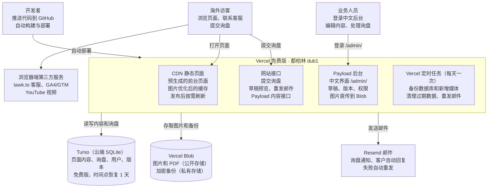

# 机械设备独立站技术方案

2026-10-19 · vito.wu

网站用 Next.js + Payload CMS 开发，部署在 Vercel，数据库用 Turso 免费版，图片和 PDF 存 Vercel Blob；前台按原型 v18 实现，后台为中文界面。本方案以需求书 v7 和《建站资料包 v7 待确认问题清单》的答复为依据。

## 目录

- [一、方案概述](#s1)
    - [1.1 建设目标与范围](#s1-1)
    - [1.2 技术选型总览](#s1-2)
    - [1.3 关键决策记录](#s1-3)
- [二、系统架构](#s2)
    - [2.1 架构总览](#s2-1)
    - [2.2 部署环境](#s2-2)
    - [2.3 渲染与缓存策略](#s2-3)
- [三、内容模型（后台数据结构）](#s3)
    - [3.1 设计原则](#s3-1)
    - [3.2 全站设置与主题](#s3-2)
    - [3.3 页面配置](#s3-3)
    - [3.4 产品（products）](#s3-4)
    - [3.5 案例（cases）](#s3-5)
    - [3.6 媒体（media）](#s3-6)
    - [3.7 询盘（inquiries）](#s3-7)
    - [3.8 用户与角色（users）](#s3-8)
    - [3.9 辅助数据](#s3-9)
- [四、前台实现](#s4)
    - [4.1 路由与网址](#s4-1)
    - [4.2 公共组件](#s4-2)
    - [4.3 首页与 Banner 轮播](#s4-3)
    - [4.4 产品与案例页面](#s4-4)
    - [4.5 表单、客服与 WhatsApp](#s4-5)
    - [4.6 手机适配与无障碍](#s4-6)
- [五、后台实现](#s5)
    - [5.1 后台界面与中文化](#s5-1)
    - [5.2 模块排序、显示隐藏与主题](#s5-2)
    - [5.3 草稿、预览、发布与版本](#s5-3)
    - [5.4 媒体上传与图片处理](#s5-4)
    - [5.5 询盘管理](#s5-5)
- [六、接口设计](#s6)
    - [6.1 提交询盘](#s6-1)
    - [6.2 重新发送询盘邮件](#s6-2)
    - [6.3 草稿预览](#s6-3)
    - [6.4 定时任务](#s6-4)
    - [6.5 获取表单令牌](#s6-5)
    - [6.6 下载备份文件](#s6-6)
- [七、第三方服务集成](#s7)
    - [7.1 邮件（Resend）](#s7-1)
    - [7.2 在线客服（tawk.to）](#s7-2)
    - [7.3 统计（GA4 + GTM）](#s7-3)
    - [7.4 YouTube 视频](#s7-4)
- [八、SEO 与性能](#s8)
    - [8.1 搜索基础配置](#s8-1)
    - [8.2 性能目标与手段](#s8-2)
- [九、安全、备份与运维](#s9)
    - [9.1 安全措施](#s9-1)
    - [9.2 备份与恢复](#s9-2)
    - [9.3 监控与维护](#s9-3)
- [十、开发计划、验收、费用与风险](#s10)
    - [10.1 实施阶段与工期](#s10-1)
    - [10.2 验收对照](#s10-2)
    - [10.3 费用清单](#s10-3)
    - [10.4 风险与待办](#s10-4)
- [十一、开发实现说明](#s11)
    - [11.1 与方案的差异](#s11-1)
    - [11.2 前台定位的实现](#s11-2)
    - [11.3 开发中按默认处理的事项](#s11-3)
    - [11.4 验证情况](#s11-4)
    - [11.5 “隐藏”勾选的范围](#s11-5)
- [参考资料](#refs)

<a id="s1"></a>

## 一、方案概述

<a id="s1-1"></a>

### 1.1 建设目标与范围

建设一个面向海外采购客户的英文 B2B 网站，用产品展示、客户案例、询盘表单和在线客服获取采购需求。目标市场为中东、南美、非洲和俄罗斯，其中俄罗斯不做专门适配。

首期交付：

- 五大栏目：Home、About Us、Products、Case Studies、Contact Us，共 7 类页面（产品和案例各有列表页和详情页）
- 辅助页面：隐私政策、Cookie 说明、提交成功页、404 页
- 全站功能：4 张 Banner 轮播、YouTube 视频、三类询盘表单和离线留言、右侧 6 个悬浮按钮、红蓝两类客服入口、手机底部按钮条
- 中文后台：前台所有文字、图片、视频、参数、按钮和链接都能修改，模块标题、按钮、标签这类固定文字也在后台维护（见 3.2 节“界面文案”）；支持草稿、预览、发布、版本恢复、角色权限和双向前台定位
- 业务内容：上线时不预置。产品、案例、图片、视频等由业务方在网站上线后自行通过后台录入，数量不设上限
- 英文界面文案：按钮、表单、提示、辅助页面等前台固定文案由 Claude 翻译提供；隐私政策和 Cookie 说明见《隐私政策与Cookie说明模板（含巴西LGPD）》

首期不做：购物车和在线支付、新闻博客（后台预留扩展）、英文以外的语言（预留方式见 8.1 节）、资质证书模块、广告账户搭建与代投。

<a id="s1-2"></a>

### 1.2 技术选型总览

| 模块 | 选型 | 选择理由 |
| --- | --- | --- |
| 前台框架 | Next.js 16（App Router）+ React + TypeScript | 与后台同一个项目部署；页面静态生成、发布时按需刷新，访问快且利于搜索收录 |
| 后台（CMS） | Payload CMS 3.x（使用 3.88 及以上，当前最新 3.91.0，均支持 Next.js 16） | 后台直接内置在网站项目中；自带简体中文界面、草稿与版本、字段级权限、媒体库、实时预览 |
| 数据库 | Turso 免费版（兼容 SQLite），通过 @payloadcms/db-sqlite 接入 | Vercel 不能持久保存本地文件；本地开发直接用 SQLite 文件，上线只换连接地址 |
| 文件存储 | Vercel Blob（@payloadcms/storage-vercel-blob，开启浏览器直传） | 绕开 Vercel 服务器 4.5MB 的上传限制；图片用公开存储，数据库备份用单独的私有存储 |
| 图片输出 | Next.js 图片组件 + Vercel 图片优化 | 按屏幕尺寸自动压缩并输出 WebP/AVIF，原图保留 |
| 样式 | Tailwind CSS + CSS 变量 | 主题档位直接映射为 CSS 变量，后台切换即生效 |
| 表单校验 | Zod | 前后端共用一套校验规则 |
| 视频 | YouTube 嵌入，点击后才加载播放器 | 不占服务器带宽，首屏不加载视频 |
| 邮件 | Resend | 免费版每月 3,000 封、每天 100 封，支持域名认证 |
| 在线客服 | tawk.to 免费版 | 支持接待、离线状态、会话记录和多客服账号；可用 JS 接口做红蓝两个自定义入口 |
| 统计 | GA4 + Google Tag Manager | 需求书指定 |
| 托管 | Vercel 免费版（Hobby），函数区域都柏林（dub1） | 业务方选用免费版；免费版条款限个人非商用，风险见 10.4 节；与 Turso 欧洲节点（爱尔兰）同城，数据库往返最快；页面由全球加速网络分发，访客速度不受函数区域影响 |
| 定时任务 | Vercel Cron | 免费版每天只能运行一次：每日数据库和媒体备份、过期数据清理和邮件重发；新询盘提交后也会顺手重发失败的邮件（见 6.4 节） |
| 代码仓库 | GitHub（账号归业务方） | 推送代码自动部署，便于交接 |

<a id="s1-3"></a>

### 1.3 关键决策记录

下表汇总《待确认问题清单》30 题的最终决定。来源分三类：业务方答复、项目方确认，以及经授权由 Claude 拟定（可调整）。Q4、Q5、Q9 由项目方确认，按下表执行。

| 题号 | 决定 | 来源 |
| --- | --- | --- |
| Q1 | 每条生产线一个页面，参数表多列对比多个型号 | 业务方 |
| Q2 | “相关设备”改为“相关生产线” | 业务方 |
| Q3 | 目标市场：中东、南美、非洲、俄罗斯；俄罗斯不做专门适配 | 业务方、项目方 |
| Q4 | 在线客服用 tawk.to 免费版；业务内容由业务方上线后在后台自行录入；域名由项目方与业务方沟通购买；其余业务信息暂不处理 | 项目方、Claude 拟定（项目方确认） |
| Q5 | 不再等参考截图，布局以原型 v18 为唯一依据 | Claude 拟定（项目方确认） |
| Q6 | WhatsApp 点击直接打开对话，保留手机底部按钮条 | 业务方 |
| Q7 | 现阶段只做英文，不考虑阿拉伯语；多语言的预留方式见 8.1 节 | 业务方、项目方 |
| Q8 | 后台在设计好的主题范围内调整样式，模块可排序和隐藏 | 业务方 |
| Q9 | 付款 30% / 40% / 30%（签约 / 样板页验收 / 上线验收）；上线后免费修复 3 个月；每阶段 5 个工作日内验收；素材在第④阶段开始前交齐 | Claude 拟定（项目方确认） |
| Q10 | 不放隐私勾选框，提交按钮下方写明“提交即表示同意隐私政策” | 业务方 |
| Q11 | 离线留言进统一询盘后台；离线留言的国家为选填 | 业务方、Claude 拟定 |
| Q12 | 三个表单都用完整国家下拉 | 业务方 |
| Q13 | 字段统一为 Phone / WhatsApp 和 Your Requirements | 业务方 |
| Q14 | 提交成功后跳转独立感谢页 | 业务方 |
| Q15 | 1 个通知邮箱；给客户自动回复；状态为新询盘 / 已联系 / 已报价 / 成交 / 无效；询盘保留 1 年；防垃圾方式见 4.5 节 | 业务方 |
| Q16 | 首页案例卡片进对应案例详情，“View All”进列表 | 业务方 |
| Q17 | 精选案例没有视频时显示封面图 | 业务方 |
| Q18 | 可生产成品只展示图片和名称，不做点击切换 | 业务方 |
| Q19 | 参数全部存在后台，勾选哪些就公开哪些；单位写在参数名称里 | 业务方 |
| Q20 | 案例详情增加产能和交付日期 | 业务方 |
| Q21 | 案例列表封面 4:3；后台图框提供 4:3、1:1、3:2、16:9 | 业务方 |
| Q22 | 社交媒体只做 Facebook、Instagram、TikTok、YouTube、LinkedIn，放页脚 | 业务方、项目方 |
| Q23 | 首期不做博客，预留扩展 | 业务方 |
| Q24 | 产品手册 PDF 直接下载 | 业务方 |
| Q25 | 不做资质证书模块 | 业务方 |
| Q26 | 视频放 YouTube 嵌入，不做备用源 | 业务方、项目方 |
| Q27 | 没有旧网站，不做 301 迁移 | 业务方 |
| Q28 | Vercel + Turso 免费版 + Vercel Blob；每日加密备份到私有存储，保留 30 份。答复原定函数区域法兰克福、每天导出 .db 文件，经技术验证改为都柏林 dub1、导出加密 SQL（见 2.2、9.2 节）；答复要求的国内登录后台实测，业务方已确认后台使用人都在海外，不再测试 | 项目方 |
| Q29 | 验收指标见 10.2 节 | Claude 拟定 |
| Q30 | 后台双重验证 + 登录失败锁定；做分享预览图和网站图标 | Claude 拟定 |

方案复查后，业务方又确认了 3 项（2026-10-20）：前台定位按需求书做双向，没有后台编辑权限的人不能从前台跳到后台（见 5.3 节）；产品、案例等业务内容由业务方直接在后台录入，开发不录入，也不迁移原型中的内容；后台使用人都在海外，不做国内访问测试。

<a id="s2"></a>

## 二、系统架构

<a id="s2-1"></a>

### 2.1 架构总览

前台、后台和接口都在 Vercel 上的同一个 Next.js 应用里（箭头表示请求方向）：



访客打开的是 CDN 上的静态页面；只有发布内容、提交询盘和定时任务才会读写 Turso 和 Blob。tawk.to、GA4 和 YouTube 由访客浏览器直接加载，不经过网站服务器。

<a id="s2-2"></a>

### 2.2 部署环境

设三套环境，生产和测试的数据完全分开，测试时不会误改线上内容。

| 环境 | 触发方式 | 数据库 | 文件存储 | 说明 |
| --- | --- | --- | --- | --- |
| 生产 | 合并到 main 分支后自动部署 | Turso 生产库 | Blob 生产存储 | 正式域名，允许搜索引擎收录 |
| 测试 | 推送其他分支或提交合并请求 | Turso 测试库 | Blob 测试存储 | Vercel 预览地址，用于阶段验收；全站 noindex，并开启 Vercel 部署保护（Vercel Authentication）；业务方审核人员用免费 Vercel 账号申请访问，或使用共享链接 |
| 本地 | 开发者电脑 | SQLite 文件（file:./dev.db） | 本地目录或 Blob 测试存储 | 不联网也能开发 |

区域：Turso 官方区域列表中欧洲只有爱尔兰节点（aws-eu-west-1，以控制台实际可选为准），因此数据库放在爱尔兰，Vercel 函数固定在都柏林（dub1），两者同城，表单提交、后台操作和备份的数据库往返最快。页面由全球加速网络分发，访客打开页面的速度不受函数区域影响。

数据库结构变更：用 Payload 的迁移文件管理。开发时生成迁移文件并提交到代码仓库，部署时先执行迁移再构建；生产环境禁止直接自动同步结构。

环境变量只保存密钥类配置，全部放在 Vercel 项目设置里，不进代码仓库：

- DATABASE_URI、DATABASE_AUTH_TOKEN：Turso 连接地址和令牌
- PAYLOAD_SECRET：后台登录加密密钥
- BLOB_READ_WRITE_TOKEN：媒体所用公开 Blob 存储的读写令牌
- BACKUP_BLOB_READ_WRITE_TOKEN：备份所用私有 Blob 存储的读写令牌
- BACKUP_ENCRYPTION_KEY：备份加密密钥（另在线下保存一份，丢失则备份无法解密）
- RESEND_API_KEY：邮件发送密钥
- CRON_SECRET：定时任务调用密钥
- PREVIEW_SECRET：草稿预览密钥
- NEXT_PUBLIC_SITE_URL：网站正式地址，用于生成规范网址和网站地图

GTM 容器编号、tawk.to 站点编号、询盘通知邮箱这类非密钥配置，放在后台“全站设置”里，修改后不用重新部署。

<a id="s2-3"></a>

### 2.3 渲染与缓存策略

所有公开页面都预先生成静态页面，访客打开页面时不查数据库。后台发布内容后，Payload 的保存钩子自动刷新受影响的页面，几秒内生效。这样页面加载快，Turso 的读取量也很小。

| 后台修改的内容 | 自动刷新的页面 |
| --- | --- |
| 全站设置、主题设置、界面文案 | 全站所有页面 |
| 首页配置 | 首页 |
| 某个产品 | 该产品详情、产品列表、首页、引用该产品的其他产品和案例详情 |
| 某个案例 | 该案例详情、案例列表（各分页）、首页、引用该案例的产品详情 |
| 关于我们、联系我们、辅助页面 | 对应页面 |
| 网址跳转规则 | 跳转规则缓存（下一次请求即生效，见 3.9 节） |

其余场景的处理方式：

- 草稿预览：用 Next.js 的草稿模式，页面实时读取草稿数据，只有登录后台的人能看到；草稿不影响线上页面。
- 表单提交、询盘导出、定时任务：动态接口，每次请求都实时处理。
- 图片：由 Vercel 图片优化按尺寸生成并缓存，原图在 Blob 中保留不动。
- 静态资源（脚本、样式、字体）：经 Vercel 全球加速网络分发。

<a id="s3"></a>

## 三、内容模型（后台数据结构）

后台由“全局配置”（全站只有一份的内容，如全站设置、首页）和“内容集合”（可以新增多条的内容，如产品、案例）组成。下表中的英文字段名即稳定业务键，取代原型的 f1、f2 编号。原型编号与正式字段名的完整对照表在第③阶段交付（见 10.1 节），因答复而取消的编号在表中注明，例如 Q18 取消成品点击切换后的 f236、f249。

<a id="s3-1"></a>

### 3.1 设计原则

1. 字段名用稳定的英文业务键，不依赖页面元素的顺序；后台显示中文名称。
2. 同一内容只存一份：产品名称和封面在首页、Banner、产品列表和详情中都引用同一条产品记录；联系方式只在全站设置里维护一次。
3. 每个字段在后台都带“前台位置”说明，例如“前台位置：首页 › Banner › 标题”。
4. 重复条目（工艺步骤、参数行、成品、优势、FAQ、相关产品、图片列表等）一律做成可新增、删除、拖动排序、单条隐藏的列表，不限条数；列表里没有可显示条目时，前台整个模块不显示。
5. 页面模块用“模块顺序”列表控制：每个模块一行，可拖动排序、勾选显示、选择背景样式；模块内容在各自的字段组里编辑。
6. 产品、案例、各页面配置、全站设置、主题和界面文案都开启草稿和版本功能，每条记录保留最近 50 个版本；不开启自动保存，由编辑人员手动“保存草稿”（原因见 5.3 节）。
7. 图片字段全部引用媒体库；每个图片位置可单独设置比例和适配方式（见 5.2 节）。

<a id="s3-2"></a>

### 3.2 全站设置与主题

**全站设置（site-settings）**

| 字段组 | 字段 | 说明 |
| --- | --- | --- |
| 品牌 | companyName、logo、footerIntro、copyright | 公司名、Logo、页脚简介、版权文字 |
| 联系方式 | email、phone、whatsapp、address、officeHours | 全站唯一来源，同步到顶栏、页脚、联系页、弹窗和悬浮栏；电话和 WhatsApp 带国际区号 |
| 社交媒体 | facebook、instagram、tiktok、youtube、linkedin | 填网址；留空的平台不显示图标；账号由业务方自行开通 |
| 导航 | navLabels | 5 项导航的显示名称，顺序固定 |
| 悬浮栏 | floatingTools | 6 个按钮的提示文字 |
| 报价引导条 | contactBand（title、text、buttonText） | 页脚上方的报价引导，所有页面共用（原型中位于各页面主体之外，字段表 f636–f638 也归在全站公共内容） |
| 表单文案 | formTexts | 字段标签、占位提示、校验提示、按钮文字、隐私说明、提交失败提示 |
| 客服 | tawkPropertyId、tawkWidgetId、redPanelTexts、bluePanelTexts | tawk.to 编号；红色窗口和蓝色欢迎面板的文字 |
| WhatsApp | whatsappMessage | 点击打开对话时预填的第一句话 |
| 询盘邮件 | notifyEmail、autoReplySubject、autoReplyBody | 通知邮箱（1 个）及给客户的自动回复模板 |
| 统计 | gtmId | GTM 容器编号 |
| 默认 SEO | titleTemplate、defaultDescription、defaultOgImage、favicon | 页面未单独设置时使用 |

**界面文案（ui-texts）**：模块标题、小标题、按钮、标签这类固定文字，需求书要求全部可在后台修改，统一放在这里。

| 字段组 | 字段 | 说明 |
| --- | --- | --- |
| 通用 | topBarTagline、footerHeadings、mobileBarTexts、contactPopoverTexts、ariaLabels | 顶栏标语、页脚栏目标题、手机底部按钮条、邮箱和电话弹层的文字，以及图标按钮、轮播、弹窗的无障碍名称 |
| 产品详情模板 | productSectionTexts | 14 个模块的默认标题、小标题和按钮文字（如 Products You Can Make、Who This Line Is For），每条产品可选填覆盖（见 3.4 节） |
| 案例模板 | caseListTexts、caseDetailTexts | 案例列表卡片上的标签、按钮和分页文字；案例详情的概况标签（Country、Capacity 等）和按钮文字；每个案例可选填覆盖（见 3.5 节） |

首页、关于我们、联系我们这类只有一份的页面，模块标题和按钮直接放在各自的页面配置里（见 3.3 节）。带默认文案的字段留空时显示默认文案；需要不显示时，勾选字段旁的“隐藏”（见 5.2 节）。

**主题设置（theme）**：只提供设计稿确认过的档位，保证怎么调都不会乱。

| 字段 | 可选值 | 说明 |
| --- | --- | --- |
| palette | 3 套配色预设（默认按原型的蓝色工业风） | 控制主色、深色区块、浅色背景 |
| quoteButtonColor | 3 种橙色 | 询盘按钮颜色；悬浮栏红色和在线沟通蓝色按需求书固定 |
| headingFont / bodyFont | 各 2 种预载字体 | 字体文件随网站一起发布，不引用外部字体服务 |
| fontScale | 偏小 / 标准 / 偏大 | 全站字号整体缩放 |
| spacingScale | 紧凑 / 标准 / 宽松 | 模块上下间距和卡片间距 |
| defaultRatios | 设备、工厂、团队、案例 4:3；成品 1:1；视频封面 16:9 | 按用途的默认图框比例，单个图片位置可另行覆盖 |

<a id="s3-3"></a>

### 3.3 页面配置

每个栏目页是一份全局配置，都带 sections（模块顺序、显示、背景）和 seo（标题、描述、分享图）字段。

**首页（home-page）**，模块默认顺序按需求书第二部分：

| 模块 | 字段 | 说明 |
| --- | --- | --- |
| banners | desktopImage、mobileImage、kicker、title、subtitle、quoteButtonText、productButtonText、product、enabled | 列表，初始 4 条，可排序和启停；手机图不填则用桌面图按焦点裁切；“查看产品”链接自动取关联产品的网址 |
| services | title、subtitle、items（icon、name） | 初始 6 项，图标从内置图标库选择 |
| companyStats | supplierLabel、stats（value、label） | 公司名自动取全站设置；初始 5 组数据 |
| aboutIntro | kicker、title、tags、companyTitle、body、buttonText | 按钮链接 About Us |
| factoryGallery | title、subtitle、images | 初始 6 张，桌面 3 列 2 行 |
| productLines | title、products | 关联产品记录，选中顺序即显示顺序 |
| featuredCases | title、subtitle、cases | 关联已发布案例，最多 3 个；不足 3 个按实际数量显示 |

各模块的小标题和按钮文字（原型 f101、f120、f150、f160、f176 等）也作为该模块的字段，开发时按字段对照表逐个补齐。页脚上方的报价引导条改为全站公共组件（见 3.2、4.2 节），首页不再单独配置。

**关于我们（about-page）**：intro（标题、正文、公司或工厂图、按钮）、scenes（生产场景与团队列表：图片、标题、说明）、capabilities（供应能力与服务列表：标题、说明），以及各模块的标题、小标题和按钮文字（原型 f447–f449、f453、f464–f465、f481–f482）。

**产品列表（products-page）**：页头标题、副标题、简介；列表按产品记录的排序显示全部已发布产品。

**案例列表（cases-page）**：页头标题、副标题、每页数量（默认 9）。

**联系我们（contact-page）**：标题、简介、配图、表单标题，以及联系方式区块的标签文字（原型 f588–f589、f593–f603）；联系方式本身自动取全站设置。

**辅助页面（pages 集合）**：隐私政策、Cookie 说明、提交成功页、404 页的标题和正文。隐私政策和 Cookie 说明的正文按《隐私政策与Cookie说明模板（含巴西LGPD）》填写。

<a id="s3-4"></a>

### 3.4 产品（products）

一条生产线一条记录，4 条生产线共用同一个详情模板。详情页 14 个模块的默认顺序按需求书第三部分，可在 sections 里调整和隐藏。产品列表的顺序在后台产品列表中拖动调整（使用 Payload 集合的 orderable 配置，已在 3.91.0 源码中确认有该配置）。

| 字段组 | 字段 | 说明 |
| --- | --- | --- |
| 基本信息 | name、nameZh、slug、productCode、category、listImage、listSummary | nameZh 为中文名，只在后台显示，不参与发布前的中文检查；category 为需求书要求的产品归属（默认 Production Lines，首期前台不做分类筛选）；slug 即网址短名，修改时自动生成永久跳转（308，见 11.1 节）；列表图和简介用于首页、产品列表和相关生产线 |
| 横幅与简介 | heroImage、heroKicker、heroSummary | 详情页顶部 |
| 可生产成品 | applications（image、name、visible） | 成品图 1:1，只展示图片和名称 |
| 图文介绍 | introduction、overviewImage | 富文本 + 全景图 |
| 设备特点与报价入口 | features、proposalTitle、proposalText、proposalButtonText | 报价按钮滚动到页底询盘表单 |
| 工艺流程 | processText、flowImage | 流程图保持原比例，可点击放大 |
| 参数表 | specTable | 自定义表格编辑器，结构见下方说明 |
| 适用客户与项目支持 | audience、projectSupport、detailImage | 安装、培训、保修、备件说明 |
| FAQ | faqs（question、answer、visible） | 可排序 |
| 运行视频 | videoUrl、videoCover、videoTitle | YouTube 链接；封面不填则用 YouTube 缩略图 |
| 设备优势 | advantages（title、description、visible） | 编号 01、02…按显示顺序自动生成 |
| 工艺步骤切换 | processSteps（title、image、description、visible） | 步骤名称和数量按实际设备设置 |
| 相关生产线 | relatedProducts | 关联其他产品记录（Q2） |
| 客户案例 | relatedCases | 关联案例记录 |
| 询盘 | formTitle、formIntro、contactImage | 表单自动带入产品名称和编号 |
| 产品手册 | brochure | PDF，前台提供直接下载按钮（Q24） |
| 模块文案覆盖 | sectionTexts | 选填；不填时使用界面文案中的产品详情模板文案（见 3.2 节） |
| SEO | seoTitle、seoDescription、ogImage、noindex | 不填时自动用产品名和简介 |

**参数表的结构**（对应 Q1、Q19）：

- specTable 是一个表格字段，用自定义编辑器维护，可以像电子表格一样增删和拖动型号列、参数行。数据以一个 JSON 字段保存在产品记录里：

```jsonc
{
  "models": [                          // 型号列，顺序即前台的列顺序
    { "id": "m1", "name": "LT-100" },  // id 自动生成且不再改变；name 为型号名
    { "id": "m2", "name": "LT-300" }
  ],
  "rows": [                            // 参数行，顺序即前台的行顺序
    {
      "id": "r1",                      // 行编号，自动生成
      "label": "Capacity (kg/h)",      // 参数名，单位直接写在名称里
      "public": true,                  // 勾选后才在前台显示
      "values": { "m1": "100", "m2": "300" } // 按型号 id 存值，调整型号顺序不会错位
    }
  ]
}
```

- 数值按型号 id 对应，调整型号顺序或删除型号都不会错位；删除型号时同时删除各行中该型号的值。
- 新建产品时自动预填需求书列出的参数行：原料、成品、产能及测试条件、包含设备、选配、功率、电压、频率、相数、尺寸、重量、材质、场地条件、交付范围、安装培训、保修与备件，默认不公开。产品编号取自 productCode，型号取自型号列，不再重复预填，保证同一内容只存一份。
- 整张表存为一个字段，每次保存只写一行数据，比拆成多层列表的写入量少得多（见 5.3 节）。
- 前台只显示公开的行；手机上参数表可横向滑动，第一列固定。

<a id="s3-5"></a>

### 3.5 案例（cases）

| 字段组 | 字段 | 说明 |
| --- | --- | --- |
| 基本信息 | title、slug、country、coverImage、summary、order | 国家从标准国家列表选择；封面 4:3（Q21）；summary 为一段项目简介，用于首页案例卡片和产品详情的案例块；order 控制列表排序 |
| 客户信息 | customerName、showCustomerName | 客户名称按可公开范围展示，不勾选则前台不显示 |
| 使用的生产线 | products | 关联产品记录，可多选 |
| 项目概况 | equipmentConfiguration、capacity、deliveryDate | Q20 增加的产能和交付日期 |
| 正文 | customerRequirements、solution、deliveryOperation | 客户需求、设备方案、交付与运行，均为富文本 |
| 媒体 | heroImage、gallery、videoUrl、videoCover | heroImage 为详情页主图，不填则用封面图；gallery 为现场图片列表；videoUrl 为 YouTube 链接，为空时首页和详情显示封面图（Q17）；videoCover 为 16:9 视频封面，不填则用 YouTube 缩略图 |
| 文案覆盖 | sectionTexts | 选填；不填时使用界面文案中的案例模板文案（见 3.2 节） |
| SEO | seoTitle、seoDescription、ogImage、noindex | 不填时自动用案例标题和概况 |

案例列表显示全部已发布案例，按 order 排序并自动分页。首页精选在首页配置里选择（见 3.3 节）。案例被撤下后自动从首页精选中消失，不留空卡片。

<a id="s3-6"></a>

### 3.6 媒体（media）

| 字段 | 说明 |
| --- | --- |
| file | 原始文件，存放在 Vercel Blob；图片支持 JPG、PNG、WebP、AVIF，单张不超过 20MB；文档仅支持 PDF，不超过 30MB；文件名自动加随机后缀，避免同名覆盖和地址被猜到 |
| alt | 替代文字，必填（英文） |
| usage | 用途：设备 / 工厂 / 团队 / 案例 / 成品 / Banner / 文档 / 其他，便于筛选 |
| focalPoint | 焦点，裁切时保证设备主体不被裁掉 |
| caption | 图片说明，可选 |
| licenseNote | 授权说明，记录图片来源和使用授权 |

视频不上传到媒体库，统一使用 YouTube 链接（Q26）。

<a id="s3-7"></a>

### 3.7 询盘（inquiries）

| 字段组 | 字段 | 说明 |
| --- | --- | --- |
| 来源 | source | contact_page（联系页）/ product_page（产品页）/ popup（联系弹窗）/ offline_message（离线留言） |
| 客户填写 | name、email、country、phone、company、productModel、requirements | 前三个表单姓名、邮箱、国家、需求必填；离线留言的国家选填 |
| 产品 | product、productName、productCode | 产品页表单自动带入；名称和编号保存当时的快照，产品改名也不影响询盘记录 |
| 访问来源 | pageUrl、landingPage、referrer、utmSource、utmMedium、utmCampaign、utmTerm、utmContent | 提交页面、首次进入的落地页、来源网站和广告参数 |
| 跟进 | status、notes、assignee | 状态：新询盘 / 已联系 / 已报价 / 成交 / 无效（Q15） |
| 邮件 | notifyStatus、notifyAttempts、notifyError、autoReplyStatus | 通知邮件和自动回复的发送状态：待发送 / 已发送 / 失败 / 不发送（可疑或无效的询盘不发自动回复，见 6.1 节） |
| 系统 | ipHash、userAgent、spamFlag、createdAt | IP 只存哈希值，用于防刷，不存原始 IP；spamFlag 为可疑标记：无 / 填写过快 / 网址过多 |

询盘只能通过前台接口新增，后台不能手工新建；保存满 1 年的记录由定时任务自动删除（Q15）。删除后的询盘最多还会在加密备份中保留 30 天，直到对应备份被清理，这一点已写入隐私政策模板。

<a id="s3-8"></a>

### 3.8 用户与角色（users）

| 角色 | 谁用 | 能做什么 |
| --- | --- | --- |
| 管理员 admin | 业务方负责人 | 全部权限，包括用户管理、全站设置和询盘 |
| 内容编辑 editor | 内容运营 | 编辑、预览、发布页面、产品、案例和媒体；看不到询盘和用户。管理员可为每个编辑账号设置可编辑范围（勾选可编辑的页面配置、全站设置，或指定产品和案例记录），默认全部 |
| 业务人员 sales | 销售 | 查看、跟进和导出询盘；内容只读 |
| 开发协作 developer | 建站开发者 | 维护内容和设置、查看备份记录；看不到询盘；不能删除管理员或修改其角色 |

登录安全（Q30）：连续 5 次密码错误锁定 15 分钟，使用 Payload 自带的登录尝试限制；双重验证用社区插件 payload-totp，开启 forceSetup，所有角色都强制设置，用手机验证器 App 生成动态码。

payload-totp 已核实（2026-10-19，并核对了 3.0.6 源码）：最新版 3.0.6 于 2026-10-04 发布，要求 Payload 3.88 及以上，与当前 Payload 最新版 3.91.0 兼容。仓库由一人维护，2026 年 10 月初公布并修复了 4 个安全漏洞：1 个高危（3.0.6 以前验证码可被暴力破解），3 个中危（如 3.0.5 以前“强制开启”只在后台界面生效、直接调用接口不受限制）。因此锁定 3.0.6 及以上的精确版本，并订阅仓库的安全公告。集成时必须落实以下 8 点：

1. 插件放在 plugins 列表的最后一个（排在导入导出插件之后），它会给所有集合和全局配置的创建、读取、修改、删除、解锁等权限包一层检查。
2. 被包装的权限对未登录访客一律拒绝，因此公开 REST 接口对匿名访问关闭。前台用 Payload 本地接口读数据，默认跳过权限检查，不受影响。保持这层拦截不关闭，正好防止机器人通过公开接口刷 Turso 的读取额度；需确认后台实时预览使用的接口能正常读取。
3. 自定义接口（6.2 节重发邮件、询盘导出）手动套上插件提供的 totpAccess，否则可以绕过双重验证。
4. 在 Next.js 的 proxy.ts 里按插件要求追加请求头；proxy.ts 只匹配插件需要的后台和接口路径，不处理前台页面（原因见 3.9 节）。
5. 把“解除锁定”的权限限制为管理员（插件默认任何已登录用户都能为他人解锁）。
6. 插件新增 totp_attempts 表，需要生成并执行数据库迁移。
7. 插件只支持一个登录集合，本方案只有 users，满足。
8. 媒体存储开启 disablePayloadAccessControl，图片和 PDF 直接从 Blob 地址读取；否则匿名访客经 Payload 读取文件会被插件拒绝。

插件自带简体中文语言包，设置和输入验证码的页面可显示中文。

验收时直接调用接口，确认未设置双重验证的账号会被拒绝。插件不可用时改用 otplib 自行实现，约需 3–5 人日。

<a id="s3-9"></a>

### 3.9 辅助数据

- redirects（网址跳转）：使用 Payload 官方跳转插件，字段为旧网址、新网址、跳转类型（308，见 11.1 节）。产品或案例修改 slug 时自动新增一条，并把指向旧网址的已有规则改为直接指向新网址，避免多次跳转和循环跳转。
- 跳转的执行方式：www 与非 www、补全结尾斜杠这类固定规则写在 next.config 的静态跳转里，由 CDN 直接执行；内容跳转只在页面找不到时查询跳转表，查询结果带缓存标签，后台修改跳转规则时刷新缓存。不在 proxy.ts 里逐个请求查库：Vercel 文档说明 proxy（Routing Middleware）在缓存之前运行，每个请求都会执行并按计算量计费；逐请求查库会增加 Turso 读取量，远离爱尔兰的访客每次打开页面还要多一次跨洲往返。
- backups（备份记录）：备份日期、文件地址、文件大小、状态、失败原因，管理员在后台可以看到每天的备份是否成功。
- 版本记录：由 Payload 版本功能自动保存，可在每条内容的“版本”页对比并恢复。

<a id="s4"></a>

## 四、前台实现

前台布局以原型 v18 为准，所有文字和图片都从后台读取，代码里不写死任何业务文案。

<a id="s4-1"></a>

### 4.1 路由与网址

网址统一以斜杠结尾，与需求书的网址结构一致。以后增加语言时，英文保持现有网址，其他语言加语言前缀（如 /es/），见 8.1 节。

| 网址 | 页面 | 导航高亮 | 是否收录 |
| --- | --- | --- | --- |
| / | 首页 | Home | 是 |
| /about/ | 关于我们 | About Us | 是 |
| /products/ | 产品列表 | Products | 是 |
| /products/{slug}/ | 产品详情 | Products | 是 |
| /case-studies/ | 案例列表第 1 页 | Case Studies | 是 |
| /case-studies/page/{n}/ | 案例列表第 n 页 | Case Studies | 是 |
| /case-studies/{slug}/ | 案例详情 | Case Studies | 是 |
| /contact/ | 联系我们 | Contact Us | 是 |
| /privacy-policy/ | 隐私政策 | 无 | 是 |
| /cookie-notice/ | Cookie 说明 | 无 | 是 |
| /thank-you/ | 提交成功页 | 无 | 否 |
| 其他不存在的网址 | 404 页 | 无 | 否 |
| /admin/ | 后台 | 无 | 否 |

<a id="s4-2"></a>

### 4.2 公共组件

以下组件在所有页面共用，文案和联系方式来自全站设置和界面文案：

- **顶栏与页头**：顶栏显示邮箱和 WhatsApp；只做英文，去掉原型里的“EN”语言切换。页头包含 Logo 和 5 项导航，手机端收起为菜单按钮。
- **页脚**：5 项导航、联系方式、社交媒体图标（5 个平台，留空不显示）、隐私政策和 Cookie 说明链接，以及“Cookie Settings”入口（访客可关闭统计，见 7.3 节）。
- **报价引导条**：页脚上方的报价引导（标题、说明、按钮），所有页面共用，文字在全站设置中维护；按钮进入联系页。
- **右侧悬浮栏**：固定在屏幕右侧垂直居中，顺序为邮箱、电话、联系我们、在线客服、返回顶部、在线沟通；前 4 个为红色圆形，返回顶部为白底红边，在线沟通为蓝色圆形且与上方间隔 20px。悬停或键盘聚焦时显示文字提示。手机上（宽度小于 768px）六个按钮默认收起成一个红色“+”按钮，放在底部按钮条上方，点开后向上展开，选了任一按钮或按 Esc 后收起；这样一整列按钮不会压住正文右侧，六个功能仍可使用（需求书第一部分：手机端调整悬浮栏尺寸或位置需先确认效果，见 11.1 节）。首页 Banner 的右箭头放在悬浮栏左侧，不被遮挡。
- **邮箱 / 电话弹层**：显示真实邮箱或带国际区号的电话，并提供 mailto 和 tel 链接。
- **联系弹窗**：用原生 dialog 实现，打开时锁定底层页面、焦点限制在弹窗内，支持 Esc 关闭，关闭后焦点回到触发按钮。
- **手机底部按钮条**：宽度小于 768px 时显示“Get a Quote”和“WhatsApp”两个按钮（Q6），悬浮栏自动上移，避免互相遮挡。
- **图片组件**：统一处理图框比例、适配方式（完整展示或填满裁切）、焦点和懒加载；设备图默认完整展示并保留留白，全景图和流程图支持点击放大。
- **模块渲染器**：按后台 sections 的顺序和显示开关渲染页面模块；模块没有可显示内容时整块不输出，不留空框。

<a id="s4-3"></a>

### 4.3 首页与 Banner 轮播

Banner 轮播规则：

1. 按后台顺序播放已启用的 Banner，每 5 秒切换一次，循环播放。
2. 提供左右箭头、圆点和暂停 / 播放按钮；圆点数量随 Banner 数量变化。
3. 鼠标停留或键盘焦点在 Banner 内时暂停，离开后继续；系统开启“减少动态效果”时不自动播放。
4. 桌面和手机分别使用各自的图片；第一张图优先加载，其余张在首屏加载完后再加载。
5. 标题、副标题和按钮是叠在图上的网页文字，不烧进图片。
6. “查看产品”进入关联产品的详情页；“Get a Quote”进入联系页，并自动把该产品填入表单。

首页其余模块按 3.3 节的配置渲染。客户案例模块显示后台选定的最多 3 个案例：有视频时显示 16:9 封面，点击后在原位播放；没有视频时显示案例封面图；标题进入对应案例详情，“View All Case Studies”进入案例列表。

<a id="s4-4"></a>

### 4.4 产品与案例页面

**产品列表**：与首页生产线模块一致，蓝色背景上的白色图文块左右交替，每块进入对应产品详情。

**产品详情**：按 sections 顺序渲染 14 个模块，要点如下：

- 工艺步骤：左侧步骤列表、右侧图片和说明，点击立即切换，也支持键盘方向键；编号按显示顺序自动生成，默认选中第一个可见步骤。
- 参数表：多型号对比，只显示公开的参数行；手机上可横向滑动，参数名列固定。
- FAQ：展开 / 收起式问答。
- 产品手册：上传了 PDF 时显示下载按钮。
- 相关生产线和客户案例：读取关联记录的名称和封面，点击进入对应详情。
- 询盘表单：自动带入当前产品的名称和编号，客户可以补充型号。

**案例列表**：网格展示封面（4:3）、标题、国家和设备；每页 9 个，超过后自动分页。

**案例详情**：项目概况表（国家、设备配置、产能、交付日期）、客户需求、设备方案、交付与运行、现场图片（可点击放大）、视频，以及“咨询类似项目”和所用生产线的链接。

<a id="s4-5"></a>

### 4.5 表单、客服与 WhatsApp

**询盘表单**：联系页、产品页、联系弹窗和离线留言共用一个表单组件和一个提交接口（见 6.1 节）。

1. 字段：Name、Email、Country / Region（完整国家下拉）、Phone / WhatsApp、Company、Product / Model、Your Requirements。
2. 必填：姓名、邮箱、国家、需求；离线留言的国家选填。
3. 提交按钮下方显示“By submitting, you agree to our Privacy Policy”并链接隐私政策，不放勾选框（Q10）。
4. 浏览器先做一次校验，服务端用同一套规则再校验一次。
5. 提交中按钮置灰；每次提交带一个随机提交编号，服务端 10 分钟内收到相同编号只保存一次，防止重复提交。
6. 服务端确认保存后才跳转到 /thank-you/；失败时停留在当前页，保留已填内容并显示失败提示。
7. 姓名、邮箱、电话、需求内容不进入网址，也不发送给统计工具。

**防垃圾询盘**（Q15 “请开发推荐”，本方案采用）：

- 隐藏陷阱字段：真人看不到，机器人填了就不保存（返回与成功相同的结果，不提示机器人）。
- 最短填写时间：从领取表单令牌（见 6.5 节）到提交不到 3 秒的，照常保存，但标记为“填写过快”，不发客户自动回复，通知邮件标题注明“可疑”。不丢弃，是为了避免用浏览器自动填充的真实客户被误判，也符合需求书“服务端确认保存后才显示成功”的要求。
- 频率限制分两层：Vercel 防火墙对询盘接口限流，每个 IP 每分钟最多 10 次，挡住突发请求（免费版每个项目只能建 1 条限流规则，询盘和表单令牌接口共用这一条；统计窗口最长 10 分钟）；代码里按 IP 哈希查询近 1 小时的提交记录，同一 IP 每小时最多 5 次。
- 内容规则：需求里超过 3 个网址的自动标记为“无效”（可疑标记记为网址过多），仍保存但不发送任何邮件。这样既避免误伤，也避免垃圾询盘触发自动回复、占用 Resend 每天 100 封的额度。
- 预留 Cloudflare Turnstile 人机验证开关：上线后垃圾询盘仍然多时再在后台开启。

**红色在线服务窗口**：由网站自己实现。窗口显示欢迎语；访客打开窗口时才连接 tawk.to，连接期间显示“Connecting…”，连上后读取客服状态：在线时显示“Start Chat”，点击后打开 tawk.to 对话；离线或连接失败时显示留言表单（姓名、电话、邮箱、国家选填、留言），提交到统一询盘后台（Q11）。

**蓝色在线沟通**：第一步的欢迎面板（Logo、公司名、欢迎语、Enter chat 按钮）由网站自己实现；点击 Enter chat 后打开 tawk.to 的对话窗口，窗口带附件、表情、输入和发送，关闭后会话保留。对话窗口是 tawk.to 自带的界面，只能设置品牌色和 Logo，与原型不完全一致；按需求书第五部分的要求，设计稿阶段先展示效果，确认后再实施。

**tawk.to 加载方式**：页面打开时不加载 tawk.to 脚本。访客第一次点击红色或蓝色入口时才加载脚本，设置 autoStart = false 并隐藏自带的右下角入口，再调用 start() 连接并打开对话窗口；对话窗口收起后再次隐藏。这样访客使用客服前不会产生任何 tawk.to 请求和 Cookie；代价是第一次打开客服时要多等脚本加载，期间显示“Connecting…”。

**WhatsApp**：顶栏、联系页、页脚和手机底部按钮条都使用 https://wa.me/{号码}?text={预填消息} 链接，在新窗口打开 WhatsApp 对话；预填消息只含网站文案和产品名，不含客户信息。

<a id="s4-6"></a>

### 4.6 手机适配与无障碍

- 屏幕分档：1180px 以上为桌面完整布局；768–1179px 为平板，多列变两列；768px 以下为手机，图文上下排列，成品图两列，其余单列。
- 重点检查宽度：360px、768px、1440px。
- 手机上输入框获得焦点时临时隐藏悬浮栏和底部按钮条，保证不遮挡提交按钮；客服面板在小屏上全宽显示。
- 图标按钮都有可访问名称；轮播、弹窗、步骤切换支持纯键盘操作；文字与背景对比度达到 WCAG AA。

<a id="s5"></a>

## 五、后台实现

后台就是 Payload 自带的管理界面，地址为 /admin/。开发重点是配置内容结构、中文化，以及少量自定义功能。

<a id="s5-1"></a>

### 5.1 后台界面与中文化

- 界面语言只启用简体中文（Payload 自带 zh 语言包），所有字段名称、分组和按钮都显示中文。
- 左侧菜单分组：页面管理（首页、关于我们、产品列表页、案例列表页、联系我们、辅助页面）、产品管理、案例管理、媒体库、询盘管理、全站设置（全站设置、主题、界面文案）、系统（用户、网址跳转、备份记录）。
- 每个字段下方显示“前台位置”和填写要求，例如建议字数、图片尺寸。
- 后台首页放置快捷入口和中文操作教程链接。
- **查找内容**：后台增加“查找内容”页面，按标题、正文文字、字段名或前台位置查找页面配置、产品和案例，包括已隐藏和已撤下的内容，点击结果跳到对应记录和字段。内容量小，在服务端读取后直接匹配，不另建索引表，避免增加数据库写入。
- 发布前自动检查：前台文字字段里如果出现中文字符（只在后台显示的字段除外，如产品中文名 nameZh），提示具体字段并阻止发布，避免中文占位误上线；必填内容和图片替代文字缺失时同样阻止发布。

<a id="s5-2"></a>

### 5.2 模块排序、显示隐藏与主题

- **模块顺序**：每个页面的 sections 列表里，一行代表一个模块，可拖动排序、勾选是否显示、选择背景（默认 / 浅色 / 深色 / 蓝色）。
- **小板块条目**：所有重复条目都是可拖动排序的列表，支持新增、复制、删除和单条隐藏。
- **单个字段的显示**：选填字段留空即不显示；标题、副标题、按钮这类带默认文案的字段，旁边提供“隐藏”勾选（留空会显示默认文案）。隐藏的内容在后台仍然保留，可随时恢复。
- **图框设置**：每个图片位置可设比例（4:3 / 1:1 / 3:2 / 16:9 / 原图比例）和适配方式（完整展示 / 填满裁切）；裁切位置取媒体库中设置的焦点。
- **主题**：在主题设置里切换配色、字体、字号和间距档位（见 3.2 节），前台通过 CSS 变量生效。
- 不提供自由拖拽布局的页面搭建器（Q8 选 B）。

<a id="s5-3"></a>

### 5.3 草稿、预览、发布与版本

1. **草稿**：编辑人员手动点“保存草稿”，草稿不影响线上页面；不开启自动保存（原因见本节末尾）。
2. **实时预览**：编辑页右侧并排显示前台效果，可切换桌面、平板、手机宽度；每次保存草稿后自动刷新，与需求书“保存草稿后在下方查看前台”的要求一致。
3. **发布**：点“发布”后内容上线，并自动刷新相关页面（见 2.3 节）。
4. **撤下**：取消发布后页面从前台、列表、首页精选和网站地图中移除；后台记录保留，可检索和恢复。
5. **版本**：每次保存都生成版本，可对比两个版本的差异并一键恢复，每条记录保留最近 50 个版本。
6. **前台定位**：定制功能，按需求书做成双向（需求书要求“从后台可以定位对应前台区域”，也可“从前台点选编辑”；业务方已确认）：
    - 后台→前台：每个字段旁有“在前台定位”按钮。点击后预览区切到对应页面或记录，自动打开字段所在的弹窗、客服面板、Banner 或工艺步骤，滚动到该元素并高亮。
    - 前台→后台：在预览中开启“定位模式”，鼠标停在文字或图片上显示后台字段名，点击后跳到后台对应字段，并自动展开所在的列表行和标签页。首页上的产品名称跳到该产品记录，页脚文字跳到全站设置。
    - tawk.to 自带的对话窗口不是网站页面，不在定位范围内。
    - Payload 后台没有现成的“跳到某个字段”功能（已确认），按后台字段的页面标识自行实现，见 11.2 节；前台组件统一给元素标注字段路径，这些标注只在预览模式下输出。
    - 权限：定位只在登录后台后的预览中可用。未登录访客看到的公开页面不输出字段路径，也没有定位入口；已登录但对该记录没有编辑权限的账号（如业务人员，或可编辑范围之外的编辑），在前台点选时提示“没有编辑权限”，不跳转到后台。服务端仍按 3.8 节的角色再校验一次，直接输入后台地址也无法绕过。
7. **内容导入导出**：产品、案例和媒体记录用官方导入导出插件导出为 JSON 并导入（3.91.0 支持 JSON 格式的导入和导出），导入时按编号保留关联记录和媒体引用；页面配置、全站设置等全局配置，在后台自定义页面中导出和导入，不新增公开接口。用于需求书“导入导出保留关联和媒体引用”的验收，以及在测试库和生产库之间迁移内容。

**为什么关闭自动保存**（已核对 Payload 3.91.0 和 @payloadcms/drizzle 3.91.0 源码）：Payload 默认在编辑停顿 2 秒后自动保存一次。每次保存时，数据库适配器会把这条记录所有列表（工艺步骤、FAQ、成品、模块顺序等）的行先全部删除、再重新写入。Turso 计算写入行数时，每个索引也要各算一次，而 Payload 给每张列表表建了 2 个索引。按一条产品约 140 行列表数据估算，每次保存约写入 800 行；免费版每月 1,000 万行，约等于 1.2 万次保存。如果开启自动保存，业务方上线后集中录入产品时，约 17–35 小时的编辑就可能用完当月写入额度并触发封库（估算值，第③阶段在测试库实测一次编辑的写入行数）。改为手动保存后，写入量只取决于点击保存的次数。

<a id="s5-4"></a>

### 5.4 媒体上传与图片处理

- 文件从浏览器直接上传到 Vercel Blob，不经过网站服务器，因此不受 Vercel 4.5MB 的请求大小限制。
- 上传时检查文件类型和大小（图片 20MB、PDF 30MB 以内），并清理文件名中的特殊字符；开启文件名随机后缀，避免同名文件互相覆盖、图片地址被猜到。
- 原图永久保留；前台由 Next.js 图片组件按屏幕尺寸请求 Vercel 图片优化，自动压缩并输出 WebP 或 AVIF。
- 后台缩略图（已核实）：按 Payload 3.91.0 源码，服务端校验直传签名后，会把原图从 Blob 下载到临时目录，再用 sharp 生成配置的各个尺寸并上传到 Blob，焦点和裁切功能可正常使用。因此 Payload 配置中启用 sharp；媒体集合只配一个后台缩略图尺寸（宽 400px），前台尺寸交给图片优化，避免每张图在 Blob 中存多份。
- 存储权限：Payload 的 Vercel Blob 直传组件固定以公开方式写入，媒体存储为公开存储（网站图片本身需要公开）；数据库备份放在另一个私有存储里（见 9.2 节）。存储插件开启 disablePayloadAccessControl，文件直接从 Blob 地址读取，不经过 Payload 转发（见 3.8 节第 8 点）。
- 删除媒体前检查是否仍被页面、产品或案例引用，有引用时阻止删除并列出引用位置。

<a id="s5-5"></a>

### 5.5 询盘管理

- **列表**：显示时间、来源、姓名、国家、产品、跟进状态、通知邮件状态；可按状态、来源、国家、产品、可疑标记和日期筛选，按姓名、邮箱、公司搜索。
- **详情**：查看全部字段，修改跟进状态和备注；通知邮件发送失败时显示“重新发送通知”按钮。
- **导出**：用 Payload 官方导入导出插件导出 CSV，按当前筛选条件导出，只有管理员和业务人员可用。插件设置 disableJobsQueue: true（同步导出，不需要队列任务）和 disableSave: true（只提供下载，不在服务器上保存导出文件；Vercel 本地磁盘不可写，询盘导出也含个人信息）。
- **删除**：只有管理员可以删除；保存满 1 年的询盘由定时任务自动删除。
- **通知邮件**：包含询盘全部字段和后台详情链接，发到全站设置里的通知邮箱。

<a id="s6"></a>

## 六、接口设计

网站自定义的接口只有下面几个，其余读写都走 Payload 自带接口。统一约定：请求和响应都是 UTF-8 编码的 JSON；给访客看的提示文字来自后台“表单文案”；Payload 自带接口对未登录访客关闭（见 3.8 节），前台通过 Payload 本地接口读取已发布内容；询盘和用户数据不对外开放。

<a id="s6-1"></a>

### 6.1 提交询盘

POST /api/inquiries，四种表单共用，无需登录。

请求参数：

```jsonc
{
  "source": "product_page",          // 来源：contact_page 联系页 / product_page 产品页 / popup 联系弹窗 / offline_message 离线留言，必填
  "name": "John Smith",              // 姓名，必填，1–100 字符
  "email": "john@example.com",       // 邮箱，必填，需符合邮箱格式
  "country": "SA",                   // 国家代码（ISO 3166-1 两位字母），前三种表单必填，离线留言选填
  "phone": "+966 50 123 4567",       // Phone / WhatsApp，选填，最多 30 字符
  "company": "ABC Foods",            // 公司名称，选填，最多 150 字符
  "productModel": "LT-300",          // 客户自己填写的产品或型号，选填
  "requirements": "We need a 300 kg/h line...", // 需求内容，必填，1–5000 字符
  "productId": "6",                  // 产品记录编号，只有产品页表单自动带入，其他表单不传
  "pageUrl": "https://www.example.com/products/latiao-production-line/", // 提交时所在页面
  "landingPage": "https://www.example.com/?utm_source=google",          // 本次访问的首个落地页
  "referrer": "https://www.google.com/",  // 来源网站，可为空字符串
  "utm": {                               // 广告来源参数，首次进入网站时记录，没有则整个对象不传
    "source": "google",                // utm_source
    "medium": "cpc",                   // utm_medium
    "campaign": "latiao-line",         // utm_campaign
    "term": "",                        // utm_term
    "content": ""                      // utm_content
  },
  "submissionId": "8f1c2b6e-5d4a-4c1e-9b7a-2f3e4d5c6b7a", // 浏览器生成的随机提交编号，用于防重复提交
  "formToken": "eyJ0Ijo...",         // 表单令牌，由 6.5 节接口签发，内含签发时间，用于最短填写时间检查
  "website": ""                      // 隐藏陷阱字段，真人提交时必须为空
}
```

成功响应（HTTP 201）：

```jsonc
{
  "ok": true,                        // 是否保存成功
  "inquiryRef": "INQ-20261019-0042", // 询盘编号，不含个人信息；前台存入本地会话，供感谢页统计去重
  "redirect": "/thank-you/"          // 前台跳转地址
}
```

失败响应：

```jsonc
{
  "ok": false,                       // 是否保存成功
  "code": "VALIDATION_ERROR",        // 错误类型：VALIDATION_ERROR 校验失败（HTTP 400）/ RATE_LIMITED 提交太频繁（HTTP 429）/ SERVER_ERROR 服务器错误（HTTP 500）
  "message": "Please check the highlighted fields.", // 给访客看的总提示
  "fields": {                        // 各字段的错误提示，只在校验失败时返回
    "email": "Please enter a valid email address." // 键为字段名，值为该字段的提示
  }
}
```

处理顺序：

1. 按 Zod 规则校验字段和表单令牌。
2. 防垃圾检查：陷阱字段、同一 IP 每小时 5 次。命中陷阱字段时，返回与成功相同的结果但不保存，不提示机器人。
3. 可疑标记：填写过快的标记为“填写过快”；需求里超过 3 个网址的标记为“网址过多”，并把状态设为“无效”。两种都照常保存。
4. 如果 10 分钟内已收到相同的 submissionId，直接返回原询盘编号，不重复保存。
5. 写入询盘表，邮件状态记为“待发送”。写入失败时（例如 Turso 不可用），把询盘全部内容直接发到通知邮箱，标题注明“数据库写入失败，需手工录入”，再返回 SERVER_ERROR：访客页面保留已填内容，并显示邮箱和 WhatsApp 联系方式。
6. 发送邮件，各自最多等待 5 秒：没有可疑标记的发通知邮件和客户自动回复；填写过快的只发通知邮件，标题注明“可疑”；网址过多的不发邮件。失败时状态记为“失败”并记录原因，交给定时任务重发。邮件失败不影响返回成功，询盘记录不会丢失。
7. 返回成功响应。

<a id="s6-2"></a>

### 6.2 重新发送询盘邮件

POST /api/inquiries/{id}/resend，由后台“重新发送通知”按钮调用，需要管理员或业务人员登录。

请求参数：

```jsonc
{
  "target": "notify"   // 重发哪封邮件：notify 内部通知邮件 / autoReply 给客户的自动回复
}
```

响应：

```jsonc
{
  "ok": true,                  // 本次发送是否成功
  "status": "sent",            // 发送后的状态：sent 已发送 / failed 失败
  "attempts": 3,               // 累计发送次数
  "error": null                // 失败原因，成功时为 null
}
```

<a id="s6-3"></a>

### 6.3 草稿预览

GET /api/preview，由后台“预览”按钮和实时预览调用，校验通过后开启草稿模式并跳转到对应页面。

请求参数（网址参数，按 JSON 展示）：

```jsonc
{
  "secret": "***",               // 预览密钥，必须等于环境变量 PREVIEW_SECRET，且请求者已登录后台
  "collection": "products",      // 内容类型：products / cases / pages，或页面配置名如 home-page
  "slug": "latiao-production-line" // 记录的网址短名，页面配置不传
}
```

响应：校验通过时返回 307 跳转到该页面的草稿模式。失败时返回一段中文纯文本，直接显示在后台的预览窗口里，写明原因和处理办法：没配置 PREVIEW_SECRET（HTTP 500）、预览密钥不一致或登录已过期（HTTP 401）、账号无预览权限（HTTP 403）、内容还没有对应的前台页面（HTTP 400）。GET /api/exit-preview 退出草稿模式。

<a id="s6-4"></a>

### 6.4 定时任务

两个定时任务由 Vercel Cron 调用，请求头必须带 Authorization: Bearer {CRON_SECRET}，否则返回 401。业务方选用 Vercel 免费版（Hobby）：定时任务每天只能运行一次（更频繁的写法部署时会报错），而且只保证在设定的那一小时内执行、不按分钟准点（2026-10-22 核对 Vercel 文档）。分开的几个任务先后顺序无法保证，所以把两项备份合成一个任务、清理和邮件重发合成一个任务，任务内部按顺序执行，两个任务错开一小时。配置写在 vercel.json（时间为 UTC）：

```jsonc
{
  "crons": [
    { "path": "/api/cron/backup", "schedule": "0 2 * * *" },     // 每天 02:00–02:59 之间：备份数据库，再增量备份新增的图片和 PDF
    { "path": "/api/cron/maintenance", "schedule": "0 3 * * *" } // 每天 03:00–03:59 之间：清理过期询盘和备份，再重发失败的询盘邮件
  ]
}
```

邮件重发不能只靠每天一次的任务：每次有新询盘提交成功、响应返回访客之后，接口会顺手重发之前失败的邮件（两种邮件各最多 3 封，不含本条；最近 5 分钟内更新过的询盘先跳过，避免几位访客同时提交时同一封邮件被重发多次）。重发的筛选规则两处相同：发送失败的，以及超过 10 分钟仍是“待发送”的；累计发送达到 10 次后不再自动重发，后台仍可手动重发。

GET /api/cron/backup 响应（数据库备份失败时照常备份媒体；任一项失败时返回 500）：

```jsonc
{
  "ok": true,                                      // 两项备份是否都成功
  "database": {                                    // 数据库备份
    "ok": true,                                    // 是否成功
    "file": "backups/db/2026-10-19.sql.gz.enc",    // 私有 Blob 存储中的备份文件路径（SQL 导出，已压缩并加密）
    "sizeBytes": 1048576,                          // 加密后的文件大小（字节）
    "tables": 42,                                  // 导出的数据表数量
    "rows": 100088,                                // 导出的总行数，约等于本次消耗的 Turso 读取行数
    "durationMs": 8200                             // 耗时（毫秒）
    // 失败时只有 ok: false、file、error（失败原因）和 durationMs
  },
  "media": {                                       // 图片和 PDF 增量备份
    "ok": true,                                    // 是否成功
    "copied": 35,                                  // 本次复制到私有备份存储的新文件数
    "copiedBytes": 52428800,                       // 本次复制的字节数
    "remaining": 0,                                // 单次最多处理 500 个文件，没处理完的数量，第二天继续
    "durationMs": 41000                            // 耗时（毫秒）
    // 失败时 ok 为 false，另有 error（失败原因）
  }
}
```

GET /api/cron/maintenance 响应（清理失败时照常重发邮件；任一项失败时返回 500）：

```jsonc
{
  "ok": true,                  // 两项是否都成功
  "cleanup": {                 // 过期数据清理
    "ok": true,                // 是否成功
    "deletedInquiries": 3,     // 删除的保存满 1 年的询盘数
    "deletedBackups": 1,       // 删除的超过 30 天的数据库备份文件数
    "deletedMediaBackups": 4   // 删除的媒体备份文件数（媒体库中已删除超过 30 天的文件）
    // 失败时只有 ok: false 和 error（失败原因）
  },
  "mail": {                    // 失败邮件重发
    "ok": true,                // 是否正常执行
    "retried": 2,              // 本次重发的邮件数（两种邮件各最多 50 封）
    "succeeded": 2,            // 重发成功数
    "gaveUp": 0                // 已达 10 次上限、不再自动重发的数量（仍可在后台手动重发）
    // 失败时只有 ok: false 和 error（失败原因）
  }
}
```

<a id="s6-5"></a>

### 6.5 获取表单令牌

GET /api/form-token，无需登录。页面是静态生成的，不能在页面里直接放每次不同的令牌，所以由这个接口签发。访客第一次点击或聚焦任一询盘表单时，前台才请求一次，不在页面打开时请求，避免每次浏览都调用接口。该接口也纳入 Vercel 防火墙限流。

请求参数：无。

响应（HTTP 200）：

```jsonc
{
  "token": "eyJ0Ijo...",   // 表单令牌：签发时间加服务端签名（用 PAYLOAD_SECRET 派生的密钥），无法伪造
  "expiresIn": 7200        // 有效期（秒）；前台提交前检查，过期则先重新领取
}
```

提交询盘时带上该令牌（6.1 节 formToken）。服务端校验签名和有效期，令牌无效时按 VALIDATION_ERROR 返回；签发后不到 3 秒就提交的，按 6.1 节标记为“填写过快”。

<a id="s6-6"></a>

### 6.6 下载备份文件

GET /api/backups/{id}/download，由后台“备份记录”的下载按钮调用；需要管理员登录并通过双重验证（套用 payload-totp 的 totpAccess，见 3.8 节）。

请求参数（网址参数，按 JSON 展示）：

```jsonc
{
  "id": "128"   // 备份记录编号，放在网址路径中
}
```

成功：HTTP 200，直接返回加密后的备份文件（以附件形式下载）。文件需用备份密钥和交付的解密脚本解密（见 9.2 节）。

失败响应：浏览器直接打开时（请求头 Accept 含 text/html，即后台点“下载”）返回一页中文说明和“返回备份记录”链接；其他调用方返回下面的 JSON：

```jsonc
{
  "ok": false,                    // 是否成功
  "code": "NOT_FOUND",            // 错误类型：UNAUTHORIZED 未登录或未通过双重验证（HTTP 401）/ FORBIDDEN 非管理员（HTTP 403）/ NOT_FOUND 备份不存在或已清理（HTTP 404）
  "message": "找不到这份备份文件：可能是失败的备份，或已超过 30 天被自动清理。"  // 中文提示文字，管理员在浏览器里直接看到
}
```

<a id="s7"></a>

## 七、第三方服务集成

所有第三方账号都用业务方的邮箱注册，开发者只以协作成员身份加入。

<a id="s7-1"></a>

### 7.1 邮件（Resend）

- **用途**：只负责发信（询盘通知和客户自动回复）；业务邮箱的收信仍用公司现有的企业邮箱。
- **发信域名**：用公司域名发信（如 noreply@公司域名），在域名解析里添加 Resend 提供的 SPF 和 DKIM 记录，并加一条 DMARC 记录，减少进垃圾箱。
- **回复地址**：通知邮件的回复地址设为客户邮箱，业务人员点“回复”就能直接联系客户；自动回复的回复地址设为业务邮箱。
- **额度**：免费版每月 3,000 封、每天 100 封。每条询盘发 2 封，相当于每天最多 50 条询盘，首期足够；超出时升级 Pro（每月 20 美元、每月 5 万封）。
- **测试**：上线前分别向 Gmail、Outlook 和公司企业邮箱发送测试询盘，确认进入收件箱而不是垃圾箱。

<a id="s7-2"></a>

### 7.2 在线客服（tawk.to）

- **账号**：业务方注册并创建站点，为每位客服开独立账号；客服可用电脑或 tawk.to 手机 App 接待，会话记录保存在 tawk.to。
- **接入方式**：站点编号填在后台全站设置；tawk.to 自带的入口始终隐藏，红蓝两个按钮通过其 JS 接口连接并打开对话窗口，对话窗口收起时再次隐藏（加载方式见 4.5 节）。
- **使用的接口**（已在官方文档核对）：autoStart 与 start（延迟连接）、getStatus 与 onStatusChange（返回 online / away / offline）、maximize（打开对话）、showWidget 与 hideWidget（显示和隐藏）、onChatMinimized（收起时再次隐藏）、onChatStarted（对话开始，用于统计）。官方注明多数回调在“弹出式聊天窗口”中不生效。
- **离线留言**：用网站自己的离线表单，进统一询盘后台；不使用 tawk.to 的离线表单，避免留言分散在两处。
- **附件**：对话中的附件由 tawk.to 接收和检查，不经过网站服务器。
- **范围**：只接入人工客服，不购买机器人或自动回答服务；免费版对话窗口带 tawk.to 标识，去掉标识是付费增值项，首期不购买。

<a id="s7-3"></a>

### 7.3 统计（GA4 + GTM）

网站只向 GTM 的数据层推送事件，GA4 和以后的广告转化都在 GTM 里配置。事件参数只含来源位置、产品名等信息，不含姓名、邮箱、电话和需求内容。

| 事件 | 触发时机 | 参数 |
| --- | --- | --- |
| generate_lead | 感谢页加载，且本地会话里有尚未统计的询盘编号；推送后立即清除编号，刷新不重复计数 | form_source（表单来源）、product_name、inquiry_ref |
| click_email | 点击邮箱链接 | location（悬浮栏 / 页脚 / 联系页） |
| click_phone | 点击电话链接 | location |
| click_whatsapp | 点击 WhatsApp 链接 | location |
| open_chat | 打开红色或蓝色客服窗口 | entry（red / blue） |
| start_chat | tawk.to 触发对话开始回调（弹出式聊天窗口中不触发，可能少计） | entry |
| download_brochure | 下载产品手册 | product_name |

- 提交失败、只点击提交按钮、刷新感谢页都不计 generate_lead。
- 以后接入 Google Ads 时，直接导入 GA4 的 generate_lead 作为转化，不再单独埋点，避免同一询盘重复计算。
- 同意设置（已按巴西 ANPD《Cookie 与个人数据保护指南》确认）：只做汇总统计、不与其他追踪手段结合、不做用户画像的分析类 Cookie，可以用“合法利益”作依据，不必先征得同意；广告类 Cookie 应先征得同意。因此首期不弹同意横幅，但必须做到：GA4 关闭 Google 信号和广告个性化、不与广告工具共享数据、数据保留期设为 14 个月；页脚提供“Cookie Settings”，访客可关闭统计（通过 Google Consent Mode 把统计设为拒绝，并用一个必要 Cookie 记住选择）；tawk.to 和 YouTube 只在访客点击后加载；Cookie 说明页列出所用 Cookie。
- 以后开启广告再营销时，必须改为同意横幅：第一层提供“拒绝非必要 Cookie”按钮，广告类 Cookie 默认关闭。
- ANPD 不建议 Cookie 政策只提供外语版本，建议隐私政策和 Cookie 说明另提供葡萄牙语版（见 10.4 节）。其他目标国家的要求未核实。
- 表单不依赖统计脚本，统计被拦截时也能正常提交询盘。
- Search Console 用域名 DNS 记录验证，上线后提交网站地图。

<a id="s7-4"></a>

### 7.4 YouTube 视频

- 后台只填 YouTube 链接，前台自动解析视频编号。
- 页面先只显示封面和播放按钮，访客点击后才加载 youtube-nocookie.com 的播放器，不自动播放声音，也不会同时下载多个视频。
- 封面优先用后台上传的图片，没有则用 YouTube 缩略图。
- 播放器加载失败时，显示“Watch on YouTube”链接和联系我们按钮，满足需求书“视频播放失败提供联系替代入口”的要求。
- YouTube 频道由业务方注册和管理，视频由业务方上传到 YouTube 后，把链接填进后台。

<a id="s8"></a>

## 八、SEO 与性能

<a id="s8-1"></a>

### 8.1 搜索基础配置

- **页面标签**：每个公开页面都有独立的标题、简介和唯一的主标题；标题模板为“页面名 | 品牌名”，后台可逐页覆盖。
- **规范网址**：以 www 为准，正式地址为 https://www.jetcomachinery.com。每页输出带斜杠结尾的完整 canonical 地址；不带 www 的 jetcomachinery.com 统一永久跳转到 www（Next 的永久跳转为 308，见 11.1 节）。正式地址取自 Vercel 生产环境的 NEXT_PUBLIC_SITE_URL，代码里不写死；跳转规则按这个地址自动生成（next.config.ts 的 hostRedirects）。
- **分享预览**：输出 Open Graph 和 Twitter Card 标签，分享图尺寸 1200×630，页面没设置时用全站默认图；网站图标和苹果触屏图标从后台上传（Q30）。
- **robots.txt**：生产环境允许抓取，排除 /admin/、/api/、/thank-you/；测试环境全部禁止，并在响应头加 noindex。
- **网站地图**：自动包含已发布的栏目页、产品、案例和辅助页面，带最后更新时间；不包含感谢页、404 和后台。
- **结构化数据**：全站输出 Organization（公司名、Logo、联系方式、社交媒体链接）和 WebSite；内页输出 BreadcrumbList；产品详情输出 Product（名称、图片、简介、品牌）。不写价格、评分、评论和认证，保证与页面实际内容一致。
- **网址变更**：产品或案例修改网址短名时自动生成永久跳转（308），旧链接不失效。
- **图片**：替代文字必填；建议文件名用英文描述。
- **多语言**：现阶段只有英文，不输出 hreflang，也不开启 Payload 的多语言配置：开启后每个可翻译字段都会多出语言表的行，增加 Turso 写入量。预留方式：所有前台文字都放在后台字段里，不写死在代码中；网址规则先定好，英文保持现有网址，以后其他语言加语言前缀（如 /es/）。以后增加语言时，需要开启 Payload 多语言并做一次数据迁移，届时单独评估工作量（Payload 能否自动迁移已有数据，未确认）。
- **上线当天**：确认 HTTPS 正常并验证 Search Console。业务内容由业务方上线后录入，因此主要页面内容录入完成前先保持 noindex；录入完成后去掉 noindex，再提交网站地图。

<a id="s8-2"></a>

### 8.2 性能目标与手段

目标（Q29）：首页、产品详情、联系页在 PageSpeed Insights 手机端测试中，LCP（最大内容绘制）不超过 2.5 秒、CLS（布局偏移）不超过 0.1；上线后用真实用户数据复核，INP（交互响应）不超过 200 毫秒。

手段：

1. 页面静态生成，经 Vercel 全球加速网络分发。
2. 第一张 Banner 图优先加载，手机使用单独的小图；其余 Banner 和非首屏图片懒加载。
3. 所有图片由 Next.js 图片组件按尺寸输出 WebP 或 AVIF，并预留固定比例的位置，加载时页面不跳动。
4. 字体随网站发布，只包含拉丁字符，不请求外部字体服务。
5. GTM 在页面可交互后加载；tawk.to 和 YouTube 都在访客点击后才加载（见 4.5、7.4 节）。
6. 图标用打包进代码的 SVG，不依赖外部图标 CDN（原型从 unpkg 加载图标，正式站不采用）。
7. 页面默认在服务端渲染，只有轮播、弹窗、表单、步骤切换和客服面板这类交互组件在浏览器运行，控制脚本体积。
8. 用 web-vitals 库把真实访客的 LCP、CLS、INP 上报到 GA4，不额外使用付费监测服务。

兼容性测试：Chrome、Edge、Firefox、Safari 最近两个大版本，iOS Safari 和 Android Chrome；屏幕宽度 360px、768px、1440px。

<a id="s9"></a>

## 九、安全、备份与运维

<a id="s9-1"></a>

### 9.1 安全措施

- **传输**：全站 HTTPS（Vercel 自动申请和续期证书），开启 HSTS。
- **安全响应头**：前台页面是静态生成的，因此内容安全策略（CSP）不用 nonce 方式（Next.js 官方文档说明，nonce 必须动态渲染，会关闭静态生成和 CDN 缓存）。前台 CSP 的脚本来源为 'self'、'unsafe-inline' 加白名单（GTM、GA4、tawk.to、YouTube、Vercel 自身；开启 Turnstile 时再加 Cloudflare），同时限制 object-src、base-uri 和 form-action。防点击劫持用 frame-ancestors 'self'：后台实时预览要在同站的框架里显示前台，不能用 X-Frame-Options: DENY。后台 /admin/ 单独使用一套策略，在第③阶段按 Payload 后台的实际需要调试。以后在 GTM 里新增广告标签时，要同步更新白名单。另加禁止 MIME 嗅探、Referrer-Policy 和 Permissions-Policy。
- **后台登录**：双重验证强制开启；连续 5 次密码错误锁定 15 分钟；密码至少 12 位；登录状态 8 小时后失效。
- **权限**：按 3.8 节的角色控制；前台通过 Payload 本地接口读取已发布内容，公开 REST 接口对未登录访客关闭（由 payload-totp 的权限包装实现，见 3.8 节），关闭不用的 GraphQL 接口；询盘接口由 Vercel 防火墙限流（见 4.5 节），防止机器人刷爆 Turso 免费版的读取额度。
- **密钥**：只存在 Vercel 环境变量里，不进代码仓库；交接时全部更换一次。
- **上传文件**：只允许图片和 PDF，禁止 SVG 和 HTML（可嵌入脚本）；限制大小并清理文件名。
- **内容输出**：富文本按结构化数据渲染，不提供可以直接写 HTML 的字段；邮件中的访客内容全部转义。
- **表单**：防刷见 4.5 节；日志里不记录完整邮箱和电话。
- **测试环境**：开启 Vercel 部署保护，只有团队成员、获批的外部 Vercel 账号和持共享链接的人可以访问（见 2.2 节）。
- **依赖更新**：开启 GitHub 依赖更新提醒，安全补丁在发布后 7 天内升级。

<a id="s9-2"></a>

### 9.2 备份与恢复

| 备份内容 | 方式 | 频率 | 保留 |
| --- | --- | --- | --- |
| 数据库（含询盘） | 定时任务导出为 SQL，压缩并加密后存入私有 Blob 存储 | 每天 02:00（UTC） | 最近 30 份 |
| 数据库时间点恢复 | Turso 免费版自带 | 持续 | 1 天 |
| 图片和 PDF | 定时任务把新增的媒体文件复制到私有备份存储（增量：文件名带随机后缀，不会原地修改，只需复制新文件） | 每天 03:00（UTC） | 媒体库中删除的文件，在备份中再保留 30 天 |
| 代码 | GitHub 仓库 | 每次提交 | 全部历史 |

**数据库备份的做法**（已在本地验证）：

1. 用 @libsql/client 在只读事务中读取表结构和全部数据，生成可直接导入的 SQL 文本：先建表并写入数据，再建索引、视图和触发器，避免导入时触发器被重复执行。远程连接时客户端会建立会话并执行 BEGIN TRANSACTION READONLY，已从 @libsql/client 0.18.0 源码确认。
2. 按 rowid 递增分页读取，每页 500 行，不用 OFFSET。OFFSET 分页的读取行数会随数据量平方增长：10 万行时每次备份约读 1000 万行，一个月约 3 亿行，占免费版读取额度的 60%，可能触发封库；按 rowid 分页时读取量约等于总行数。
3. 边读边写入临时文件并用 gzip 压缩，再用 AES-256-GCM 加密，避免整份数据放在内存里。
4. 上传到单独的私有 Blob 存储（Vercel 私有存储已于 2026-06-30 正式可用），写入备份记录，保留最近 30 份。

本地验证结果：测试库模拟 Payload 的表结构（外键、唯一索引、触发器、视图、JSON 文本、二进制数据、空值、引号、换行、中文、emoji），分别测试 3,000 行和 10 万行。两轮还原后，表结构和 6 张表的内容都与原库逐字节一致，完整性检查和外键检查都通过。10 万行时导出用时 0.53 秒，SQL 文件 16MB，压缩后约 1MB。

注意事项：

- 备份里有用户的密码哈希和双重验证密钥，泄露就等于后台失守，所以必须加密，并且只放在私有存储里；加密密钥另在线下保存一份。
- 备份失败时给管理员发邮件提醒，并在后台“备份记录”中显示失败原因。
- 每天的备份任务都会读取数据库，可避免 Turso 免费版数据库闲置 10 天被归档。
- Turso 免费版删除的数据库不保证能找回，时间点恢复也只能回滚 1 天，所以我们自己的每日备份是主要的恢复手段。
- 询盘满 1 年被删除后，最多还会在备份中保留 30 天，隐私政策中已写明。
- 待实测：远程会话的超时和实际导出耗时，在第③阶段用测试库验证。函数在都柏林、数据库在爱尔兰同城时，10 万行约 200 次往返，估计十几秒内完成，远低于 Vercel 函数默认 300 秒的上限。
- 备选方案：用 GitHub Actions 每天运行 Turso 官方的 turso db export 命令。

恢复步骤（交接时演示一次）：

1. 在后台备份记录中下载指定日期的备份文件（6.6 节接口），用备份密钥和交付的解密脚本解密并解压，得到 SQL 文件。
2. 用 sqlite3 把 SQL 文件导入为新的 .db 文件，并把日志模式设为 WAL（Turso 导入时要求）。
3. 用 Turso 命令行工具 turso db import 把该文件导入为一个新数据库。
4. 把 Vercel 环境变量里的数据库地址和令牌换成新数据库，重新部署。
5. 如需恢复媒体，把私有备份存储中的文件复制回媒体存储的原路径。
6. 抽查首页、产品、案例和询盘，确认数据完整。

<a id="s9-3"></a>

### 9.3 监控与维护

- **监控**：用 Vercel 自带的部署通知和函数日志查看错误；可另外接入免费的网站在线监测（如 UptimeRobot），属于可选项。
- **免费修复期**：上线后 3 个月内，属于开发问题的故障免费修复（Q9）；之后的维护另行约定。

| 事项 | 负责方 | 频率或时限 |
| --- | --- | --- |
| 网站打不开、询盘无法提交等紧急故障 | 开发 | 4 小时内响应 |
| 一般问题 | 开发 | 工作日 24 小时内响应 |
| 系统和依赖升级 | 开发 | 每月一次；安全补丁 7 天内 |
| 检查备份记录 | 开发 | 每月一次 |
| 内容更新 | 业务方 | 随时 |
| 域名续费 | 业务方 | 每年，建议开启自动续费 |
| Vercel 和其他服务账单 | 业务方 | 每月，绑定公司支付方式 |

<a id="s10"></a>

## 十、开发计划、验收、费用与风险

<a id="s10-1"></a>

### 10.1 实施阶段与工期

预计开发周期约 9.5 周，不含业务方准备素材和审核的等待时间。比上一版多约 1.5 周，来自本次复查补充的参数表编辑器、双向前台定位、后台查找内容、内容导入导出、编辑权限范围和界面文案配置（估算值）。阶段划分沿用需求书第八部分的①–⑥。

| 阶段 | 主要工作 | 预估工期 | 交付物 | 付款 |
| --- | --- | --- | --- | --- |
| ① 确认与准备 | 签约；买好域名（第③阶段开始前必须完成 Resend 域名认证，见 10.4 节）；开通 GitHub、Vercel（免费版）、Turso、Resend、tawk.to、GA4/GTM 账号 | 0.5 周 | 账号清单、测试地址 | 30% |
| ② 设计稿 | 首页、产品列表、产品详情、案例、联系我们的桌面和手机关键界面；确认 tawk.to 对话窗口的替代样式 | 1 周 | 设计稿 |  |
| ③ 后台与样板页 | 内容模型（含界面文案和参数表编辑器）、中文后台、角色与双重验证、编辑权限范围、全部公共组件、首页、一条完整的产品页、询盘接口与邮件、草稿预览发布、双向前台定位、每日备份 | 4 周 | 可操作的后台和样板页；原型字段编号与正式字段名的对照表 | 40%（样板页验收后） |
| ④ 其余页面与集成 | 其余页面、tawk.to、GA4/GTM、YouTube、SEO、其余定时任务、后台查找内容、内容导入导出；填入 Claude 翻译的英文界面文案和隐私政策；录入一套测试数据供验收（业务内容不由开发录入，见 10.4 节） | 2.5 周 | 完整的测试站 |  |
| ⑤ 测试地址验收 | 按 10.2 节逐项测试；性能、浏览器和设备测试；修改问题 | 1 周 | 验收记录 |  |
| ⑥ 上线与交接 | 切换正式域名、清除测试数据、提交 Search Console、演示恢复、后台培训、移交账号和资料 | 0.5 周 | 正式网站、交接清单 | 30%（上线验收后） |

每个阶段结束后，业务方在 5 个工作日内验收（Q9）。交接资料按需求书第八部分“必须交付的资料”准备：源码与部署说明、各服务账号和权限清单、备份与恢复说明、中文后台操作教程、验收记录和维护约定；密码通过密码管理工具单独交接。

<a id="s10-2"></a>

### 10.2 验收对照

以需求书第九部分的验收清单为准，下表补充测试方法和量化标准。

| 验收项 | 测试方法 | 通过标准 |
| --- | --- | --- |
| 导航与网址 | 逐页打开、刷新、复制链接到新窗口 | 5 项导航顺序正确，内页高亮正确，每页有独立网址 |
| 首页与 Banner | 观察轮播；悬停、键盘、箭头、圆点、暂停按钮逐一操作 | 每 5 秒切换，暂停正确，4 张各自跳转到对应产品 |
| 产品与案例 | 逐条生产线检查 14 个模块、多型号参数表、步骤切换、手册下载 | 图框按用途比例显示、不拉伸；只显示公开参数；手机无溢出 |
| 悬浮栏与弹窗 | 7 类页面逐一检查；滚动、切换页面、Esc 关闭 | 始终在右侧，蓝色按钮间隔 20px；焦点正确返回 |
| 在线客服 | 客服在线和离线各测一次，含附件 | 在线能对话，消息和附件到达 tawk.to 后台；离线留言进入询盘后台 |
| 询盘送达 | 4 种表单各提交一次；临时停用邮件密钥再提交一次 | 后台有记录、来源和产品正确、收到通知和自动回复；邮件失败时记录不丢失并能重发 |
| 后台编辑 | 业务方独立修改 Banner、文案、参数、媒体、联系方式、主题、模块顺序，预览后发布并恢复历史版本；新增第 4 个案例 | 前台正确更新；首页仍是选定的最多 3 个案例 |
| 条目增删 | 删除一个步骤并新增第 7 个；新增参数行；调整 FAQ 顺序；隐藏成品；清空一个模块 | 编号、图片和说明正确；清空的模块整块不显示；其他产品不受影响 |
| 性能 | PageSpeed Insights 手机端测首页、产品详情、联系页，各测 3 次取中间值 | LCP ≤ 2.5 秒，CLS ≤ 0.1 |
| 兼容性 | 按 8.2 节的浏览器和宽度矩阵测试 | 无重叠、遮挡和功能失效 |
| 搜索与统计 | 检查标签、网站地图、robots；提交询盘后刷新感谢页 | HTTPS 和地图正常；GA4 实时报告中 generate_lead 只记 1 次 |
| 前台定位 | 每类页面随机抽查标题、正文、按钮、提示、图片和视频；从后台字段点“在前台定位”，再从前台点回后台；再用业务人员账号和退出登录状态各试一次 | 都能找到后台字段并定位到前台，包括弹窗、客服面板和第 2–4 张 Banner 中的内容；未登录或没有编辑权限时，前台没有定位入口或提示无权限，不能跳到后台 |
| 后台查找 | 按标题、正文文字、字段名查找，包括已隐藏和已撤下的内容 | 能找到并跳到对应记录和字段 |
| 内容导入导出 | 导出一条产品和一个案例，再导入测试库 | 关联的产品、案例和媒体引用都保留 |
| 备份与交接 | 按 9.2 节演示一次恢复；核对账号归属 | 恢复后数据完整；全部账号归业务方所有 |

<a id="s10-3"></a>

### 10.3 费用清单

下表是上线后的持续费用，一次性开发费用以报价单为准。价格取自各家官网（查询日期 2026-10-19），以付款时为准。

| 项目 | 方案 | 费用 |
| --- | --- | --- |
| Vercel | 免费版（Hobby） | 0；每月有固定用量额度（如图片优化转换 5,000 次、函数调用 100 万次、防火墙限流 100 万次请求），超出后要等 30 天才能继续使用对应功能；如需升级，Pro 每月 20 美元起，含 20 美元用量额度，每个开发成员席位 20 美元/月 |
| Turso | 免费版 | 0（保持免费版，已知限制见 10.4 节）；如需升级，Developer 约 4.99 美元/月（按年付） |
| Resend | 免费版 | 0（每月 3,000 封）；超出时 Pro 20 美元/月 |
| tawk.to | 免费版 | 0；去掉窗口标识为付费增值项，首期不买 |
| GA4、GTM、Search Console | 免费 | 0 |
| GitHub | 免费版 | 0 |
| 域名 | 业务方已有或新注册 | 按注册商价格每年续费 |
| 企业邮箱 | 公司现有邮箱 | 不新增 |

免费版没有团队协作功能（已核对 Vercel 文档），也就没有席位费用；开发者不是该 Vercel 账号的成员，推送到私有仓库的代码能否自动部署未确认，需在第①阶段实测，不行时改为由业务方账号部署。升级 Pro 后，私有仓库的代码提交者必须是团队成员并按席位收费。测试站用 Vercel 账号授权或共享链接限制访问（免费版可用），密码保护仅 Pro 版提供。

<a id="s10-4"></a>

### 10.4 风险与待办

| 事项 | 影响 | 应对 | 负责方 |
| --- | --- | --- | --- |
| 域名已购买（www.jetcomachinery.com），Resend 域名认证尚未完成 | Resend 未认证域名时只能发信给账号本人的邮箱（已核对 Resend 文档），第③阶段无法测试通知邮件和客户自动回复 | 第③阶段开始前在 Resend 认证 jetcomachinery.com（按第七章添加 SPF、DKIM、DMARC 记录），MAIL_FROM 改用该域名的发件地址；正式域名在第⑥阶段切换：Vercel 项目里绑定 www.jetcomachinery.com 和 jetcomachinery.com，生产环境的 NEXT_PUBLIC_SITE_URL 填 https://www.jetcomachinery.com（见 8.1 节）；品牌、联系方式等信息由业务方上线后在后台填写 | 项目方 |
| 业务内容由业务方在上线后自行录入 | 上线初期页面内容为空或不完整；需求书写的是开发录入（报价含录入数量、第④阶段录入内容、交付物含产品与案例数据），与现决定不一致；测试地址上没有真实内容可验收 | 业务方已确认由业务方直接在后台录入，相应修订需求书或合同中的录入条款；开发录入一套测试数据用于验收，上线前清除；业务方录入完成后复验 Banner 与产品对应、参数表等项；空模块自动隐藏，不用占位上线；主要页面内容录入完成前保持 noindex；交接时做后台录入培训 | 业务方 |
| Turso 免费版任一额度（存储、读取、写入、同步）超限即封库，且不能开超额付费；免费版删除的数据库不保证能找回 | 询盘无法提交、后台无法使用 | 公开 REST 接口对匿名访问关闭，询盘接口由 Vercel 防火墙限流；关闭草稿自动保存、参数表存为单个字段，减少写入量（见 5.3 节）；数据库写入失败时询盘直接发到通知邮箱（见 6.1 节）；备份按 rowid 分页，不放大读取量；每月检查一次用量，任一项超过额度的 50% 时评估升级 Developer（约 4.99 美元/月，可开超额、时间点恢复 10 天）；每日加密备份兜底 | 开发、业务方 |
| Turso 服务条款没有明确允许商用（条款对免费和付费用户措辞相同）；Turso 已于 2026-10-02 宣布被 Supabase 收购，免费版政策可能调整 | 合规与政策变动风险 | 签约前邮件向 Turso 支持索取书面确认并存档；关注政策变化；数据为标准 SQLite，必要时可迁移 | 开发 |
| Vercel 免费版条款限个人非商用。按 Vercel 的定义，参与网站制作的任何人从中获得经济利益就算商用（例子包括宣传销售产品或服务、收费建站或托管），本站展示产品、收集询盘且为付费开发，属于商用（2026-10-26 核对 Vercel 文档和服务条款）；免费版用量超额后要等 30 天才能继续使用对应功能（如图片优化每月 5,000 次转换） | 条款允许 Vercel 不经通知关停免费版上的项目，违反政策时可能直接暂停账号或部署；被停后升级 Pro 能否立即恢复，文档没写（未确认）；超额时图片等功能暂停 | 建议上线前升级 Pro（每月 20 美元起，见 10.3 节），代码不用改；Vercel 后台关注用量 | 业务方 |
| 隐私政策和 Cookie 说明只有英文 | ANPD 不建议 Cookie 政策只提供外语版本，对巴西访客的告知可能不充分 | 建议这两页另做葡萄牙语版（由 Claude 翻译），作为辅助页面发布 | 项目方 |
| 双向前台定位（业务方已确认做双向） | 工作量较大，Payload 后台没有现成的“跳到某个字段”功能（已确认） | 已解决：已按后台字段的页面标识实现，见 11.2 节 | 开发 |
| Q4、Q5、Q9 已由项目方确认 | 付款节点、验收期限和“以原型 v18 为准”按 1.3 节执行 | 写入合同或报价单，签约时双方确认 | 项目方 |
| tawk.to 对话窗口与原型样式不完全一致 | 验收争议 | 设计稿阶段先展示并确认 | 开发 |
| payload-totp 为单人维护的社区插件，2026 年 10 月初刚修复 4 个安全漏洞（含 1 个高危） | 以后再出漏洞时需要及时升级 | 锁定 3.0.6 及以上版本；第③阶段开头按 3.8 节的 8 个集成要点验证；订阅仓库安全公告；不可用时改用 otplib 自行实现 | 开发 |
| 数据库备份已在本地验证，连接真实 Turso 远程库时的耗时和只读事务待实测（9.2 节） | 备份可靠性 | 第③阶段用测试库实测，并做一次恢复演练 | 开发 |
| Resend 免费版每天 100 封上限 | 询盘特别多时邮件延迟 | 失败邮件会自动重发；连续超出时升级 Pro | 业务方 |
| 没有 1688 参考截图（Q5） | 布局理解偏差 | 以原型 v18 为准，设计稿阶段确认 | 开发 |

已关闭：浏览器直传后能否生成后台缩略图。已按 Payload 3.91.0 源码确认可以正常生成（见 5.4 节）。

<a id="s11"></a>

## 十一、开发实现说明

2026-10-21 补充。记录代码实现与前文方案不一致或方案未写明的地方，以代码为准。

<a id="s11-1"></a>

### 11.1 与方案的差异

- **样式**：1.2 节写的是 Tailwind CSS + CSS 变量；实现沿用原型 v18 的 CSS，主题档位仍映射为 CSS 变量。原型样式已经完整，直接移植能保证外观与原型一致。
- **Payload 接口路径**：Payload 自带接口从默认的 /api 改到 /api/cms，/api 下其他路径留给网站自己的接口（询盘、预览、备份下载、定时任务）；GraphQL 关闭。
- **版本**：Next.js 固定为 16.4.2（@payloadcms/next 3.91.0 要求 Next 16 系列不低于 16.3.3），Node.js 24.x。
- **结尾斜杠跳转**：next.config 里的永久跳转在 Next 中是 308，不是 301，搜索引擎同样按永久跳转处理。只对前台页面补斜杠，接口和后台不跳转。Next 会自动给跳转规则追加可选的结尾斜杠，规则里用 (?!.*/$) 排除已带斜杠的地址，否则会自己跳自己。
- **内容网址跳转**：产品、案例改网址短名后的旧网址跳转也是 308。页面里只能用 permanentRedirect，状态码固定为 308；要返回 301 只能在 proxy.ts 里给每个请求查一次跳转表，3.9 节已说明不这样做（每个请求都计费、增加 Turso 读取和跨洲往返）。网址跳转的“跳转类型”相应记为 308（迁移 20261022_064852_redirect_type_308 把已有的 301 记录改为 308）。
- **收录开关**：全站设置新增“允许搜索引擎收录”（默认关闭），对应 8.1 节“主要页面内容录入完成前保持 noindex”。关闭时 robots.txt 全站禁止抓取、页面输出 noindex；测试环境始终 noindex。
- **邮件重发**：除发送失败的邮件外，超过 10 分钟仍是“待发送”的也会重发（提交请求在写库之后被中断时会停在这个状态）。
- **Vercel 免费版与定时任务**：1.2 节原定 Vercel Pro，业务方改用免费版。免费版定时任务每天只能运行一次、只保证在设定的那一小时内执行，原来每 15 分钟一次的邮件重发部署时会直接报错；原来 02:00 备份数据库、02:30 清理、03:00 备份媒体，在一小时的浮动下先后顺序也无法保证。所以合并成两个任务（02 点备份、03 点清理加重发），任务内部按顺序执行；另外每次新询盘提交成功后顺手重发失败的邮件，失败邮件不必等到第二天（见 6.4 节）。
- **询盘邮件状态**：通知和自动回复两封邮件并行发送，发送状态合并成一次更新写回。分开更新同一条询盘时，后写的会把先写的状态覆盖掉。
- **后台邮件**：Payload 自带的邮件（如后台“忘记密码”）也通过 Resend 发送。没有配置发信时只打印到日志，生产环境的日志只记收件人和主题，不写正文，避免重置链接和客户资料进入日志。
- **文案默认值**：后台仍预填默认文案，但默认值写成函数形式，不进入数据库列默认值。Payload 生成迁移时会给每行 SQL 加缩进，多行默认值（如自动回复正文）的换行后面会多出空格。
- **内容导入导出**（修正 5.3 节第 7 点）：
    - 官方导入导出插件处理时，会按用户编号重新查一次当前用户。查出来的用户没有“本次会话已通过双重验证”的标记，payload-totp 会拒绝：询盘 CSV 导出请求挂住，产品、案例导入全部失败。代码里在插件的接口和钩子外面记下当前会话，重新查出同一个用户时补回这个标记，权限规则不变。
    - 产品、案例的 JSON 导入只适合在同一个网站里按编号更新内容，这样能保留关联和媒体引用。插件的“新建”模式会去掉记录编号，换到另一个库后关联对不上。
    - 媒体库不支持导入，导入工具不会带上图片和 PDF 文件。
    - 测试站和正式站之间整体迁移内容，改用数据库备份恢复（9.2 节），再复制 Blob 里的媒体文件。
    - 导入、导出时上传的 JSON / CSV 只在本次请求里处理，不写本地磁盘（插件默认写到 ./imports、./exports，Vercel 的函数目录不可写）。
- **后台左侧菜单**：Payload 自带菜单固定先排全部集合、再排全部全局配置，按 5.1 节的顺序排不出来（“全站设置”会排在“系统”后面，“辅助页面”会排在首页前面）。改为自定义菜单组件，复用 Payload 导出的菜单部件，只调整分组和条目顺序。后台首页的集合卡片同样问题，用自带卡片组件生成后按同一顺序重排（两处共用 src/admin/navOrder.ts），卡片的锁定提示和新建按钮不变。
- **操作教程**：教程写在 docs/后台操作教程.md，后台 /admin/guide 页面运行时读取这份文件并转成富文本显示，后台首页放入口链接，文档和后台始终是同一份。
- **隐私政策与 Cookie 说明**：用 npm run import:legal 从 docs 里的模板导入“辅助页面”，自动填入公司名称、地址、网址和日期；模板里的表格用富文本编辑器的表格功能（Payload 3.91.0 中仍标为实验功能）保存和显示。
- **服务端日志**：询盘写库失败时只记录错误类型和第一行说明（截掉数据库报错里附带的 SQL 参数），不记录客户填写的内容；未配置发信时，生产环境日志里的收件人邮箱打码。
- **Banner 默认比例**：主题“默认图框比例 › Banner”选具体比例时只在桌面按比例定高度，手机保持原设计的高度，避免手机上 Banner 过矮、文字放不下。
- **手机悬浮栏收起**（待业务方确认效果）：原型和需求书是一列六个按钮常驻右侧，手机上会压住 Banner 文字、参数表等正文右侧。改为默认收起成一个按钮、点开展开（见 4.2 节）。需求书第一部分要求手机端调整悬浮栏须先确认效果，确认前可改回常驻一列。
- **手机页头**：原型手机页头是一行（Logo 与菜单按钮同一行）。实现时 Logo 图压到 32px 高，公司名在 Logo 下方用小字（最多两行），菜单按钮留在右侧，页头约 75px 高。
- **产品详情的文章小节**：“图文介绍”到“运行视频”是同一列文章的几个小节，相邻且背景相同时连成一列，小节之间约 40px，同原型；不再各自带上下内边距。
- **404 与感谢页标题**：浏览器标签标题按英文界面文案第十八章套用标题模板（Page Not Found | 公司名、Thank You | 公司名）。产品、案例找不到和兜底路由显示 404 时也返回同一个标题，否则浏览器接管页面后标签标题会被清空。
- **后台提示**：发布前中文检查的汇总提示按后台语言显示中文字段名；页面配置和设置从没发布过时，保存按钮旁提示“还没有发布过：前台目前显示的是默认内容”；“在前台定位”按钮在焦点进入抽屉或弹窗时隐藏，层级低于 Payload 的抽屉。
- **复制失败**：邮箱 / 电话弹层的复制先用剪贴板接口，不可用时改用临时文本框复制；都失败时按钮显示 “Copy failed” 并选中文字，方便访客手动复制。

<a id="s11-2"></a>

### 11.2 前台定位的实现

- **后台字段的页面标识**（按 Payload 3.91.0 核对）：普通字段的 id 为 field-{路径}，路径中的点换成两个下划线；富文本字段没有 id，用字段标签的 for 属性识别；折叠分组的 id 为 field-collapsible-{上级路径}_index-{序号}；数组行的 id 为 {数组路径}-row-{行号}。
- **懒渲染**：Payload 后台只渲染视口附近的字段，折叠分组里的字段在展开前不在页面上。定位时先按字段配置算出目标字段外层的分组、数组和数组行，从外到内逐层展开并滚动到视口里，等字段出现后再聚焦，最多等 6 秒。
- **滚动范围**：实时预览在后台的 iframe 里，前台定位只滚动预览页本身，不带动外层后台页面。
- **权限**：前台点选时先查当前账号对该内容的编辑权限，没有权限时提示，不跳转。
- 升级 Payload 后要回归测试这个功能。

<a id="s11-3"></a>

### 11.3 开发中按默认处理的事项

《前台英文界面文案》中标为“开发确认”的几项，按以下方式实现，业务方有不同意见时再调整：

- tawk.to 客服状态为“暂时离开”（away）时按离线处理，显示离线留言表单。
- 联系弹窗不放 Product / Model 字段。
- Product / Model 最长 150 个字符。
- 电话只校验长度（最长 30 个字符），不校验格式。
- 蓝色面板连接客服失败时，显示提示和 “Send an Inquiry” 按钮。

<a id="s11-4"></a>

### 11.4 验证情况

- **自动检查**：25 项单元测试、代码检查、类型检查、生产构建全部通过；数据库迁移在空库上执行成功，建出的表结构与开发库一致。
- **本地浏览器实测**：首页、产品详情、联系页、感谢页、404；悬浮栏的弹窗和两个客服面板、Cookie 设置、手机端布局；询盘提交（校验提示、入库、通知和确认邮件、重复提交去重、陷阱字段、可疑标记、令牌校验）；后台首次绑定双重验证、实时预览、双向定位、备份下载的权限；数据库备份、解密、还原。
- **未验证**：Resend 实际发信、Vercel Blob 直传与图片优化、Turso、Vercel Cron、tawk.to、GTM、Turnstile 需要真实账号，本地只验证了“未配置”时的行为；业务人员账号点选定位时的“没有编辑权限”提示还没有在浏览器里实测；同一 IP 每小时 5 条的限流没有实测。

<a id="s11-5"></a>

### 11.5 “隐藏”勾选的范围

5.2 节“单个字段的显示”已实现（2026-10-22 与项目方确认范围）：带默认文案的标题、小标题、副标题和按钮，旁边有“隐藏”勾选。勾选后前台不输出这段文字，模块其他内容照常显示；文字仍保留在后台，取消勾选即可恢复。

| 后台位置 | 带勾选的字段 |
| --- | --- |
| 首页 | 需求与服务标题；公司数据通栏身份标签；公司简介小标题、标题、公司名标题、按钮；厂房展示小标题、标题；生产线模块标题、卡片按钮；客户案例小标题、标题、卡片链接、底部按钮 |
| 首页 › 每张 Banner | 小标题、报价按钮、产品按钮 |
| 关于我们 | 公司介绍小标题、标题、按钮；生产场景标题；供应能力标题 |
| 产品列表页 / 案例列表页 / 联系我们 | 产品列表副标题；案例列表模块标题、模块副标题；联系页小标题、标题、表单标题 |
| 全站设置 › 报价引导条 | 标题、说明、按钮（三项都隐藏时整条不显示） |
| 界面文案 › 产品详情模板 | 横幅小标题和按钮、各模块的小标题和标题、报价入口标题和按钮、两种卡片按钮、询盘区说明，共 24 项 |
| 界面文案 › 案例详情 | 返回链接、项目概况标题、三个正文小节标题、现场图片标题、视频标题、所用生产线标题和链接、主按钮、次按钮，共 11 项 |
| 界面文案 › 其他 | 顶栏标语；产品卡片按钮；案例卡片链接；感谢页小标题、WhatsApp 引导、两个按钮；404 页三个按钮 |
| 产品（每条记录） | 横幅小标题、报价入口标题、报价按钮、视频标题、询盘区标题、询盘区说明 |

- **不加勾选**：页面主标题（h1）；表单、导航、悬浮栏、手机底部按钮条、客服窗口、Cookie 弹窗等功能性文字；案例概况行名、参数表表头、分页等结构性标签；读屏文字、邮件模板、SEO 模板和 WhatsApp 预填消息；默认文案为空的字段（留空即不显示）。
- **产品和案例的“模块文案覆盖”**：不单独加勾选，在“界面文案 › 产品详情模板 / 案例详情”统一隐藏；某条记录自己填了覆盖文字时仍然显示。
- **案例详情“所用生产线”的链接文字被隐藏时**，改为点生产线名称进入详情，保证仍能跳转。
- **预览定位**：被隐藏的文字不在前台页面上，“在前台定位”会提示当前预览页面里没有这个字段。

<a id="refs"></a>

## 参考资料

查询日期 2026-10-19。价格和额度以各家官网付款时为准。

已打开核对的页面：

- [Turso Pricing](https://turso.tech/pricing)：免费版和付费版的额度与价格（免费版每月写入 1,000 万行）；免费版超额即封库、删除的数据库不保证可恢复；写入行数包含索引更新
- [Turso 服务条款](https://turso.tech/terms-of-use)：使用范围条款对免费和付费用户相同
- [Turso 加入 Supabase 公告](https://turso.tech/blog/turso-is-joining-supabase)：2026-10-02 宣布被收购，平台继续运行
- [Turso 嵌入式副本](https://docs.turso.tech/features/embedded-replicas/introduction)、[Turso 时间点恢复](https://docs.turso.tech/features/point-in-time-recovery)、[Turso 数据库导出命令](https://docs.turso.tech/cli/db/export)：备份与恢复方式
- [Vercel Pricing](https://vercel.com/pricing)：Hobby 仅限个人非商用、Pro 价格、Blob 与图片优化计费
- [Resend Pricing](https://resend.com/pricing)：免费版每月 3,000 封、每天 100 封
- [Payload：在 Vercel 上使用 SQLite 和 Turso](https://payloadcms.com/posts/guides/how-to-set-up-payload-with-sqlite-and-turso-for-deployment-on-vercel)：Turso 接入方式，以及 Vercel 本地文件不持久的说明
- [Payload 语言包目录](https://github.com/payloadcms/payload/tree/main/packages/translations/src/languages)：包含简体中文 zh
- [Payload 存储适配器](https://payloadcms.com/docs/upload/storage-adapters)：clientUploads 用于绕开 Vercel 4.5MB 上传限制
- [Turso 区域列表接口](https://docs.turso.tech/api-reference/locations/list)：示例中欧洲只有爱尔兰节点
- [Vercel 定时任务额度](https://vercel.com/docs/cron-jobs/usage-and-pricing)、[Vercel 防火墙限流](https://vercel.com/docs/vercel-firewall/vercel-waf/rate-limiting)：免费版定时任务每个项目最多 100 个、每天一次、在设定的那一小时内执行；免费版限流规则 1 条、统计窗口最长 10 分钟（2026-10-22 核对）
- [Vercel Hobby 套餐](https://vercel.com/docs/plans/hobby)、[Vercel 函数运行时长](https://vercel.com/docs/functions/configuring-functions/duration)：免费版用量额度、超额后等 30 天、仅限非商用、无团队协作，函数最长运行 300 秒（2026-10-22 核对）
- [Vercel 合理使用准则](https://vercel.com/docs/limits/fair-use-guidelines)、[Vercel 服务条款](https://vercel.com/legal/terms)、[Vercel 账号或部署被暂停的原因](https://vercel.com/kb/guide/why-is-my-account-deployment-blocked)：商用的定义和例子、免费版项目可被不经通知关停、违反政策时可能直接暂停（2026-10-26 核对）
- [tawk.to JavaScript API](https://developer.tawk.to/jsapi/)：本方案使用的接口和回调
- [Next.js 内容安全策略指南](https://nextjs.org/docs/app/guides/content-security-policy)：nonce 需要动态渲染，静态页面用不带 nonce 的策略
- [Vercel Routing Middleware](https://vercel.com/docs/routing-middleware)：在缓存之前运行、按计算量计费
- [Vercel 图片优化限制](https://vercel.com/docs/image-optimization/limits-and-pricing)：图片优化的计费与限制
- [Vercel 部署保护](https://vercel.com/docs/deployment-protection)、[Vercel Authentication](https://vercel.com/docs/deployment-protection/methods-to-protect-deployments/vercel-authentication)：测试站的访问方式，免费版可用账号授权和共享链接，密码保护为 Pro 版每个项目每月 20 美元
- [Vercel 项目协作说明](https://vercel.com/docs/deployments/troubleshoot-project-collaboration)：Pro 版私有仓库的提交者必须是团队成员，按席位收费
- [Resend：resend.dev 域名的 403 错误](https://resend.com/docs/knowledge-base/403-error-resend-dev-domain)：未认证域名时只能发信给账号本人
- [ANPD《Cookie 与个人数据保护指南》](https://www.gov.br/anpd/pt-br/documentos-e-publicacoes/guia-orientativo-cookies-e-protecao-de-dados-pessoais.pdf)：分析类 Cookie 的合法依据与横幅建议做法
- [payload-totp 仓库](https://github.com/GeorgeHulpoi/payload-totp)、[payload-totp 安全公告](https://github.com/GeorgeHulpoi/payload-totp/security/advisories)：功能、集成要求和已修复的漏洞

已核对的源码：Payload 3.91.0、@payloadcms/drizzle 3.91.0、@payloadcms/plugin-cloud-storage 3.91.0、@payloadcms/storage-vercel-blob 3.91.0、@payloadcms/plugin-import-export 3.91.0、payload-totp 3.0.6、@libsql/client 0.18.0 的 npm 包，用于确认直传文件与图片尺寸、导入导出、双重验证权限、远程只读事务、草稿自动保存和列表数据写入的处理逻辑。

开发时需要逐项核对的文档（本方案只看过搜索摘要）：

- [Payload SQLite 适配器](https://payloadcms.com/docs/database/sqlite)
- [Payload 导入导出插件](https://payloadcms.com/docs/plugins/import-export)
- [Payload 后台多语言配置](https://payloadcms.com/docs/configuration/i18n)
- [Vercel 私有 Blob 正式上线公告](https://vercel.com/changelog/vercel-private-blob-is-now-generally-available)
- [Vercel 函数限制](https://vercel.com/docs/functions/limitations)
- [Payload 支持 Next.js 16 的说明（第三方博客）](https://www.buildwithmatija.com/blog/payload-cms-nextjs-16-compatibility-breakthrough)
